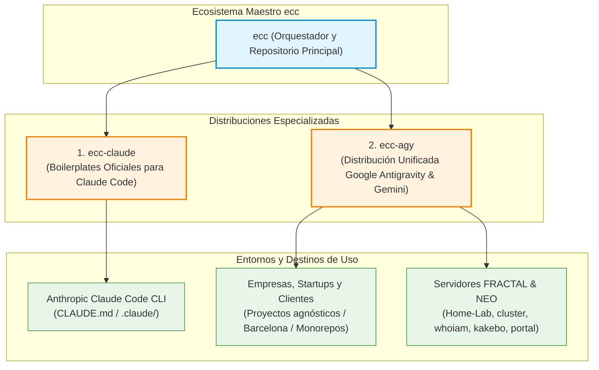

# Ecosistema ECC (`ecc`)

> **Distribución Maestra Multi-Harness: Claude Code + Google Antigravity & Gemini**  
> Repositorio Principal: [`ACB75/ecc`](https://github.com/ACB75/ecc)

---

## 1. Visión y Arquitectura

`ecc` es el repositorio raíz y núcleo de orquestación que unifica y desacopla las diferentes adaptaciones de **Everything Claude Code (ECC)** según el motor de IA y el contexto de despliegue:



---

## 2. Catálogo de Distribuciones

| Distribución | Harness | Propósito | Estado de Acoplamiento |
| ------------ | ------- | --------- | ---------------------- |
| **[`ecc-claude`](ecc-claude/)** | Claude Code | Boilerplates nativos de Claude Code (`CLAUDE.md`, `.claude/`, hooks y comandos slash). | Totalmente agnóstico, estándar oficial de ECC. |
| **[`ecc-agy`](ecc-agy/)** | Google Antigravity | Distribución unificada para Antigravity & Gemini con 315+ skills, 73+ subagentes, comandos, esquemas y SRE baseline. | **Unificado y Modular**: Apto para $N$ proyectos, empresas externas y laboratorios con control estricto de gobernanza. |

---

## 3. Instalador Rápido (`install.ps1` / `install.sh`)

Instalación rápida mediante un único comando según el objetivo deseado:

```powershell
# 1. Para usar en un proyecto nuevo con Claude Code
pwsh -File install.ps1 -Target claude -Destination C:\Ruta\A\MiProyecto

# 2. Para desplegar el plugin unificado en Google Antigravity
pwsh -File install.ps1 -Target agy
```

---

## 4. Repositorios GitHub Asociados

- **Repositorio Principal**: [`https://github.com/ACB75/ecc`](https://github.com/ACB75/ecc)
