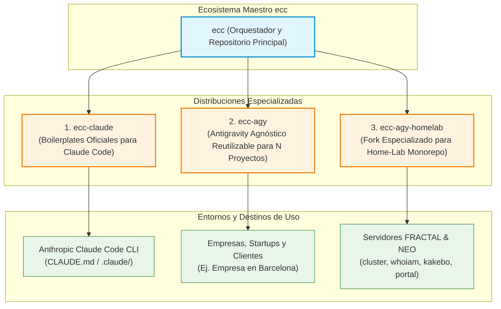

# Ecosistema ECC (`ecc`)

> **Distribución Maestra Multi-Harness: Claude Code + Antigravity Agnóstico + Fork Home-Lab**  
> Repositorio Principal: [`ACB75/ecc`](https://github.com/ACB75/ecc)

---

## 1. Visión y Arquitectura

`ecc` es el repositorio raíz y núcleo de orquestación que unifica y desacopla las diferentes adaptaciones de **Everything Claude Code (ECC)** según el motor de IA y el contexto de despliegue:



---

## 2. Catálogo de Distribuciones

| Distribución | Harness | Propósito | Estado de Acoplamiento |
| ------------ | ------- | --------- | ---------------------- |
| **[`ecc-claude`](ecc-claude/)** | Claude Code | Boilerplates nativos de Claude Code (`CLAUDE.md`, `.claude/`, hooks y comandos slash). | Totalmente agnóstico, estándar oficial de ECC. |
| **[`ecc-agy`](ecc-agy/)** | Google Antigravity | Distribución agnóstica para Antigravity con 16 skills, 12 subagentes y SRE baseline. | **100% Desacoplado**: Listo para $N$ proyectos o empresas externas sin fuga de datos. |
| **[`ecc-agy-homelab`](ecc-agy-homelab/)** | Google Antigravity | Fork especializado con gobernanza Home-Lab, `/portal`, cluster, kakebo, whoiam. | Especializado para infraestructura física del laboratorio ([ADR-0008](https://github.com/ACB75/home-lab/blob/main/doc/adr/0008-software-reliability-engineering-baseline.md)). |

---

## 3. Instalador Rápido (`install.ps1` / `install.sh`)

Instalación rápida mediante un único comando según el objetivo deseado:

```powershell
# 1. Para usar en un proyecto nuevo con Claude Code
pwsh -File install.ps1 -Target claude -Destination C:\Ruta\A\MiProyecto

# 2. Para usar en una empresa o proyecto genérico con Antigravity
pwsh -File install.ps1 -Target agy

# 3. Para trabajar en el ecosistema Home-Lab con Antigravity
pwsh -File install.ps1 -Target homelab
```

---

## 4. Repositorios GitHub Asociados

- **Repositorio Principal**: [`https://github.com/ACB75/ecc`](https://github.com/ACB75/ecc)
- **Fork Home-Lab**: [`https://github.com/ACB75/ecc-agy-homelab`](https://github.com/ACB75/ecc-agy-homelab)
