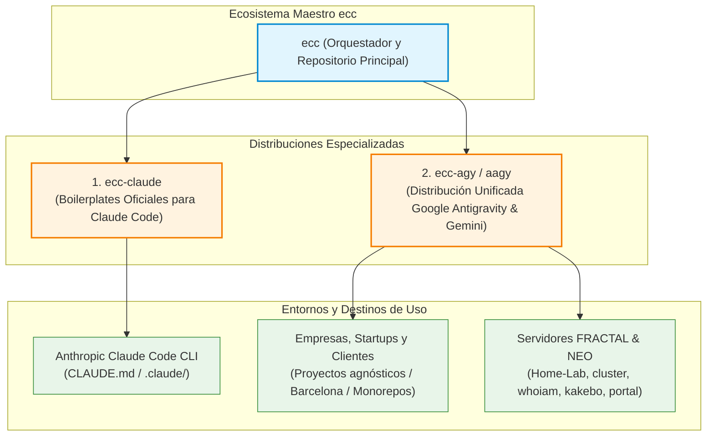

# Ecosistema ECC (`ecc`)

> **Distribución Maestra Multi-Harness: Claude Code + Google Antigravity & Gemini**  
> Repositorio Principal: [`ACB75/ecc`](https://github.com/ACB75/ecc)  

---

## 1. Visión y Arquitectura

`ecc` es el repositorio raíz y núcleo de orquestación que unifica y desacopla las diferentes adaptaciones de **Everything Claude Code (ECC)** según el motor de IA y el contexto de despliegue:



---

## 2. Catálogo de Distribuciones y Arquitectura Two-Tier

| Distribución | Harness | Propósito | Estado de Acoplamiento |
| :--- | :--- | :--- | :--- |
| **[`ecc-claude`](ecc-claude/)** | Claude Code | Boilerplates nativos de Claude Code (`CLAUDE.md`, `.claude/`, hooks y comandos slash). | Totalmente agnóstico, estándar oficial de ECC. |
| **`ecc-agy` (Root)** | Google Antigravity & Gemini | Plugin universal (`aagy` / `ecc-agy`) con arquitectura en dos niveles (Two-Tier): Tier 1 Global Plugin con 21 skills nucleares (~701 tokens, reducción 98.25%) y Tier 2 con 169 skills y 48 subagentes canónicos en repositorio. | **Unificado y Agnóstico**: Apto para $N$ proyectos, clientes y monorepos con compuertas estrictas de calidad y gobernanza. |

---

## 3. Instalador Multiplataforma (`install.ps1` / `install.sh`)

Instalación rápida mediante un único comando según el objetivo deseado:

```powershell
# 1. Para usar en un proyecto nuevo con Claude Code
pwsh -File install.ps1 -Target claude -Destination C:\Ruta\A\MiProyecto

# 2. Para desplegar el plugin unificado en Google Antigravity (Tier 1 Global recomendado)
pwsh -File install.ps1 -Target agy -Profile minimal
```

En entornos Linux / WSL / macOS (POSIX LF):

```bash
# 1. Boilerplates Claude Code
./install.sh claude /ruta/a/mi-proyecto

# 2. Plugin unificado Antigravity (Tier 1)
./install.sh agy
```

---

## 4. Documentación y Gobernanza

- 📑 **[`doc/INDEX.md`](doc/INDEX.md)**: Índice maestro de manuales, diagramas Mermaid, ADRs y gobernanza.
- 🚦 **[`doc/STATUS.md`](doc/STATUS.md)**: Estado actual de salud, SonarQube Rating A y métricas operacionales.
- 📜 **[`doc/LOG.md`](doc/LOG.md)**: Registro histórico de decisiones materiales y cambios arquitectónicos.
- 🏛️ **[`doc/adr/`](doc/adr/README.md)**: Registro formal de Decisiones de Arquitectura (ADR-0001, ADR-0002).
- 🩺 **[`doc/post-mortem/`](doc/post-mortem/TEMPLATE_POSTMORTEM_5W.md)**: Marco de autopsias SRE 5W (*blameless*).
- ⚙️ **[`.governance/docs-map.json`](.governance/docs-map.json)**: Contrato canónico de roles de documentación.
