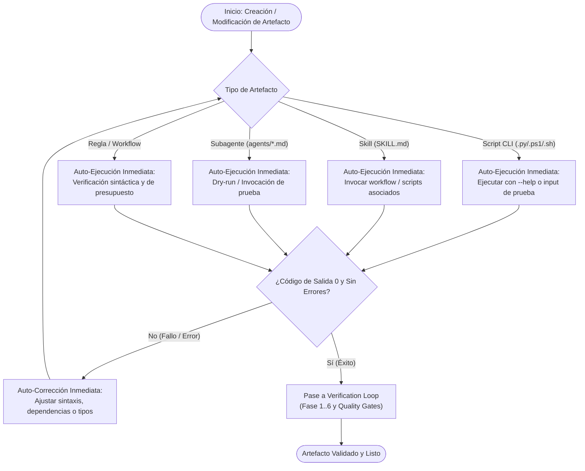

# Plan de Arquitectura y Requisitos: Autoejecución Inmediata de Artefactos Creados (`Smoke-Test on Synthesis`)

> **Referencia de Gobernanza**: Generado a partir de [`doc/TEMPLATE_REQUISITOS_ARQUITECTURA.md`](file:///C:/Workspace/projects/home-lab/doc/TEMPLATE_REQUISITOS_ARQUITECTURA.md) para dar cumplimiento a la regla obligatoria de análisis pre-implementación, autoejecución inmediata de artefactos creados y validación de calidad.

---

## 1. Contexto y Metadatos de la Petición

- **Proyecto / Módulo**: `ecc-agy` (plugin global) / `scripts` (monorepo `home-lab`)
- **Tipo de Intervención**: Nueva Regla de Gobernanza y Reajuste de Skill/Subagente Existentes
- **Fecha**: 2026-10-25
- **Objetivo Principal**: Establecer la regla mandatoria de que todo artefacto recién sintetizado o modificado (scripts, skills, subagentes, herramientas o reglas) se autoejecute de inmediato tras su creación (smoke-test / auto-validación en tiempo de ejecución), reajustando la skill `verification-loop` y el subagente `tdd-guide` sin crear dependencias redundantes.

---

## 2. Toma de Requisitos Detallada y Criterios de Aceptación

### 2.1. Requisitos Funcionales (`RF`)

- **`RF-01` (Regla de Autoejecución Inmediata)**: Incluir en `AGENTS.md` (global y sincronizado en repo `ecc-agy`) el principio de *Immediate Auto-Execution on Creation*: ningún script, skill, subagente o workflow creado puede darse por concluido sin haber sido ejecutado al menos una vez (ej. flag `--help`, suite de tests unitarios, o dry-run funcional) verificando código de salida `0`.
- **`RF-02` (Reajuste Óptimo de Skill `verification-loop`)**:
  - Incorporar la **Fase 0: Net-New Artifact Self-Execution** al flujo de verificación estándar.
  - Actualizar el frontmatter `description` manteniendo el límite estricto de $\le 140$ caracteres.
  - Detallar los comandos canónicos de auto-ejecución inmediata para scripts (`.py`, `.ps1`, `.sh`), skills y subagentes.
- **`RF-03` (Reajuste Óptimo de Subagente `tdd-guide`)**:
  - Extender las responsabilidades del subagente para auditar y exigir que todo nuevo script, test o herramienta creada se auto-ejecute inmediatamente tras su creación.
  - Mantener el frontmatter `description` dentro del límite de $\le 120$ caracteres y el modelo compatible (`inherit` o `flash`).
- **`RF-04` (Sincronización Total del Ecosistema)**: Mantener total paridad entre `~/.gemini/config/plugins/ecc-agy/` y `C:\Workspace\projects\ecc-agy/`.

### 2.2. Requisitos No Funcionales (`RNF`)

- **`RNF-01` (Eficiencia de Tokens)**:
  - Skill description $\le 140$ caracteres (1 línea).
  - Subagente description $\le 120$ caracteres (1 línea).
  - Cero bloating de reglas con tutoriales innecesarios.
- **`RNF-02` (Cero Dependencias de Terceros)**: Uso exclusivo de los comandos y scripts estándar del repositorio (`pwsh`, `python`, `sed`, `git`).
- **`RNF-03` (Compatibilidad Multiplataforma)**: Soporte completo para Windows 11 (`pwsh`) y Debian 12 (`bash`).

### 2.3. Casos Límite (*Edge Cases*) y Condiciones de Fallo

- **Scripts destructivos o con mutaciones en producción**: La auto-ejecución en creación debe emplear flags `--dry-run`, `--help` o entornos de pruebas aislados (ej. `tmp_path` en pytest) para evitar efectos secundarios indeseados.
- **Subagentes de solo lectura**: La autoejecución debe validar el contrato de mínimo privilegio y la ausencia de herramientas de escritura en su frontmatter.
- **Fallo de importación o sintaxis al ejecutar**: Si la auto-ejecución arroja código distinto de `0` o excepción, el agente entra en bucle de auto-corrección inmediata antes de continuar.

### 2.4. Criterios de Aceptación (`CA`)

- [ ] **`CA-01`**: La regla de auto-ejecución en creación está documentada y formalizada en `AGENTS.md` y `GEMINI.md`.
- [ ] **`CA-02`**: La skill `verification-loop/SKILL.md` incorpora la Fase 0 de autoejecución de artefactos nuevos con descripción $\le 140$ caracteres.
- [ ] **`CA-03`**: El subagente `tdd-guide.md` incorpora la directiva de auto-ejecución inmediata con descripción $\le 120$ caracteres y modelo permitido.
- [ ] **`CA-04`**: Diagrama Mermaid persistido en `doc/ecc-agy/diagrama/auto_execution_on_creation.mmd`.
- [ ] **`CA-05`**: La ejecución de `audit-workspace.ps1 -Clean` aprueba las 4 fases sin incidencias de higiene, presupuesto de tokens ni calidad SonarQube.

---

## 3. Auditoría de Reutilización y Retrocompatibilidad

### 3.1. Inventario de Activos Reutilizados

- **Skill `verification-loop`**: Reutilizada y ampliada en lugar de crear una skill nueva, evitando duplicidad conceptual.
- **Subagente `tdd-guide`**: Reutilizado y ajustado con la directiva de auto-ejecución en lugar de introducir un agente nuevo.
- **Scripts de auditoría**: [`scripts/bin/ecc-agy/audit-workspace.ps1`](file:///C:/Workspace/projects/home-lab/scripts/bin/ecc-agy/audit-workspace.ps1).

### 3.2. Impacto en Contratos y Estrategia de Retrocompatibilidad

- **Contratos Afectados**: Ninguno. Todos los cambios son estrictamente compatibles y aditivos.
- **Zero-Breaking Changes**: Los flujos existentes de `verification-loop` (Fases 1 a 6) permanecen intactos.

---

## 4. Arquitectura, Clean Code y Diagrama de Flujo

### 4.1. Flujo de Auto-Ejecución en Creación

### 4.2. Usabilidad (UX / DX)

- **DX**: El desarrollador y el agente obtienen retroalimentación en tiempo real de fallos de importación, sintaxis o rutas rotas inmediatamente al crear una herramienta, eliminando "código muerto" o herramientas rotas no probadas.

---

## 5. Seguridad, Robustez y Bastionado

| Vector de Amenaza | Riesgo | Mitigación y Bastionado |
| :--- | :---: | :--- |
| **Ejecución de scripts con efectos secundarios no deseados** | Medio | En creación, la auto-ejecución debe usar flags informativos (`--help`, `--version`, `--dry-run`) o suites de pruebas con mocks / carpetas temporales. |
| **Inyección de comandos vía wrappers** | Bajo | Invocación con argumentos debidamente escapados y validados. |
| **Exceso de herramientas en agentes de solo lectura** | Medio | Verificación estricta de la regla de mínimo privilegio en `workspace-audit.py`. |

---

## 6. Análisis de Costes de la Decisión Arquitectónica

### 6.1. Costes Visibles

- **Esfuerzo de Implementación**: Muy bajo (<15 minutos).
- **Consumo de Tokens**: Prácticamente nulo; reutilización de descripciones compactas ($\le 140$ y $\le 120$ caracteres).
- **Sobrecarga de Ejecución**: Un comando adicional de smoke-test tras la síntesis de un archivo ejecutable.

### 6.2. Costes Ocultos

- **Mantenibilidad a Largo Plazo**: Muy positiva; evita que se acumulen scripts o herramientas defectuosas en el repositorio.
- **Carga Cognitiva**: Nula; automatizado por las pautas del subagente y la skill de verificación.
