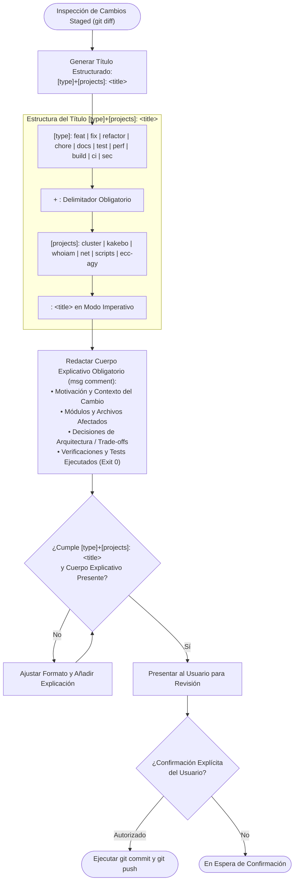

# Plan de Arquitectura y Requisitos: Regla Estándar de Formato de Commits (`[type]+[projects]: <title>`) y Cuerpo Explicativo Obligatorio

> **Cumplimiento de Regla Global ECC-AGY**: Planificación técnica detallada previa a la incorporación de la regla obligatoria de nomenclatura de commits con prefijo de proyecto compuesto y cuerpo explicativo mandatorio.

---

## 1. Contexto y Metadatos de la Petición

- **Proyecto / Módulo**: `ecc-agy` (plugin global) / `scripts` (monorepo `home-lab`)
- **Tipo de Intervención**: Nueva Regla de Gobernanza, Actualización de Skill y Validador de Commits
- **Fecha**: 2026-10-25
- **Objetivo Principal**: Estandarizar la redacción de commits en todo el monorepo y ecosistema para que todos los commits utilicen estrictamente la sintaxis de título `[type]+[projects]: <title>` y vayan siempre acompañados de un mensaje explicativo (*body comment*) detallando el contexto, decisiones y verificaciones realizadas.

---

## 2. Toma de Requisitos Detallada y Criterios de Aceptación

### 2.1. Requisitos Funcionales (`RF`)

- **`RF-01` (Sintaxis Canónica del Título de Commit)**:
  - Todo commit debe llevar un título con el patrón: `[type]+[projects]: <title>`.
  - `[type]`: Tipo Conventional Commit válido (`feat`, `fix`, `refactor`, `chore`, `docs`, `test`, `perf`, `build`, `ci`, `sec` o `security`).
  - `+`: Delimitador literal que vincula el tipo con el alcance de proyectos.
  - `[projects]`: Lista de proyectos o módulos impactados en el monorepo (`cluster`, `kakebo`, `whoiam`, `net`, `scripts`, `ecc-agy`, `doc`, o lista separada por comas en caso de cambios transversales como `cluster,net`).
  - `: <title>`: Dos puntos seguidos de espacio y título imperativo descriptivo en minúsculas (sin punto final).
- **`RF-02` (Cuerpo Explicativo Obligatorio — *msg comment*)**:
  - Ningún commit puede ser de una sola línea (*single-line commits prohibidos*).
  - El título debe separarse por una línea en blanco seguida de un cuerpo explicativo estructurado que aborde:
    1. Motivación, problema resuelto o necesidad del cambio.
    2. Componentes, submódulos o contratos intervenidos.
    3. Decisiones arquitectónicas relevantes, mitigaciones de seguridad o patrones aplicados.
    4. Verificación técnica ejecutada (tests unitarios, comprobaciones en vivo, quality gates).
- **`RF-03` (Prohibición de Commits Autónomos Preservada)**:
  - La regla mantiene la prohibición estricta de ejecutar `git commit` o `git push` de forma autónoma. El agente redacta la propuesta conforme al nuevo estándar y la somete a confirmación del usuario antes de ejecutar.
- **`RF-04` (Validador y Generador CLI — `format_commit.py`)**:
  - Implementar un script en Python (`scripts/ecc-agy/format_commit.py`) y wrappers (`scripts/bin/ecc-agy/format-commit.ps1` y `.sh`) que permita:
    - Validar si un mensaje de commit cumple la regla (`--validate <file>` o string).
    - Generar el borrador formateado (`--type`, `--projects`, `--title`, `--body`).
- **`RF-05` (Actualización de Skill `conventional-commit-review`)**:
  - Actualizar `skills/conventional-commit-review/SKILL.md` documentando el estándar `[type]+[projects]: <title>` y la obligatoriedad del cuerpo explicativo, manteniendo la descripción $\le 140$ caracteres.

### 2.2. Requisitos No Funcionales (`RNF`)

- **`RNF-01` (Eficiencia de Tokens)**:
  - Frontmatter de la skill `conventional-commit-review` $\le 140$ caracteres.
  - Reglas redactadas con máxima densidad informativa sin redundancias.
- **`RNF-02` (Cero Dependencias No Oficiales)**:
  - Script en Python 3 utilizando exclusivamente la biblioteca estándar (`argparse`, `dataclasses`, `re`, `sys`, `pathlib`).

### 2.3. Criterios de Aceptación (`CA`)

- [ ] **`CA-01`**: La regla está redactada e integrada en `rules/AGENTS.md`, `AGENTS.md` (ecc-agy y home-lab) y `GEMINI.md`.
- [ ] **`CA-02`**: La skill `skills/conventional-commit-review/SKILL.md` refleja el formato `[type]+[projects]: <title>` y cuerpo obligatorio con frontmatter $\le 140$ caracteres.
- [ ] **`CA-03`**: El script `format_commit.py` valida y formatea mensajes de commit exitosamente con tests en `test_format_commit.py` (100% pasando).
- [ ] **`CA-04`**: Diagrama Mermaid persistido en `doc/ecc-agy/diagrama/commit_format_standard.mmd`.
- [ ] **`CA-05`**: `audit-workspace.ps1 -Clean` aprueba las 4 fases con 0 incidencias.

---

## 3. Arquitectura y Flujo de Validación de Commits

---

## 4. Análisis de Costes de la Decisión Arquitectónica

### 4.1. Costes Visibles
- **Esfuerzo de Implementación**: ~15 minutos.
- **Longitud del Historial Git**: Mensajes de commit más ricos y estructurados (mayor trazabilidad en `git log`).

### 4.2. Costes Ocultos
- **Mantenimiento**: Nulo. Aporta un valor incalculable para arqueología de código, bisección de errores y auditoría regulatoria de cambios.
