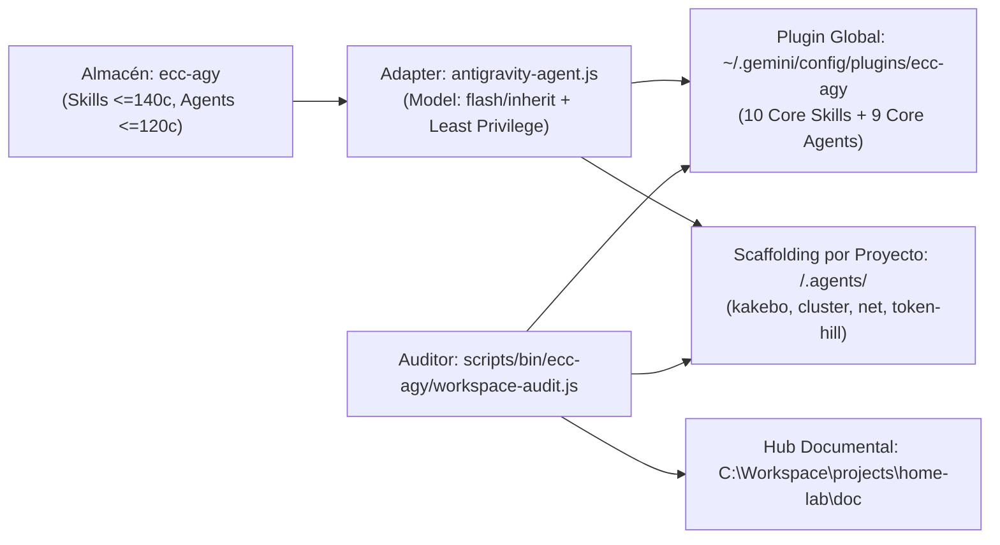

# Toma de Requisitos, Diseño de Arquitectura, Seguridad y Análisis de Costes — Optimización Integral ECC-AGY

## 1. Contexto y Metadatos de la Petición

- **Proyecto / Módulo**: `ecc-agy | scripts | doc | kakebo | cluster | net | token-hill`
- **Tipo de Intervención**: `Refactorización Arquitectónica | Optimización de Tokens y Gobernanza`
- **Fecha**: `2026-10-24`
- **Objetivo Principal**: Sincronizar todas las actualizaciones recientes de `AGENTS.md` (plantilla obligatoria de arquitectura, automatización en `scripts/bin/<project>`, presupuestos de frontmatter $\le 140$/$\le 120$ caracteres, modelos `flash`/`inherit` con mínimo privilegio y centralización documental en `C:\Workspace\projects\home-lab\doc`) y re-optimizar el ecosistema completo.

---

## 2. Toma de Requisitos Detallada y Criterios de Aceptación

### 2.1. Requisitos Funcionales (`RF`)

- **`RF-01` (Sincronización de Reglas Base)**: Unificar byte a byte [`C:\Workspace\projects\ecc-agy\AGENTS.md`](file:///C:/Workspace/projects/ecc-agy/AGENTS.md) y [`C:\Users\Master\.gemini\config\plugins\ecc-agy\rules\AGENTS.md`](file:///C:/Users/Master/.gemini/config/plugins/ecc-agy/rules/AGENTS.md).
- **`RF-02` (Optimización de Skills y Subagentes)**:
  - Ajustar todas las skills activas (Fase 1 global y Fases 2–5 por proyecto) a una `description` de una sola línea $\le 140$ caracteres con palabras clave de activación y límites negativos.
  - Ajustar todos los subagentes activos a una `description` $\le 120$ caracteres, modelo `flash` (exploración/documentación) o `inherit` (razonamiento profundo) en [`antigravity-agent.js`](file:///C:/Workspace/projects/ecc-agy/scripts/lib/install/antigravity-agent.js), y herramientas de mínimo privilegio (eliminando permisos de escritura en agentes revisores/arquitectos/planificadores).
  - Depurar las fases de [`ecc-agy-sync.ps1`](file:///C:/Workspace/projects/ecc-agy/ecc-agy-sync.ps1) y [`ecc-agy-sync.sh`](file:///C:/Workspace/projects/ecc-agy/ecc-agy-sync.sh) eliminando skills de otros stacks (`frontend-patterns` React y `jpa-patterns` Hibernate en `kakebo`; `backend-patterns` Node/Express en `cluster`; separando la fase `token-hill` para CLI Python puro).
- **`RF-03` (Automatización en `scripts/bin/<project>`)**:
  - Estructurar todos los scripts operativos bajo `C:\Workspace\projects\home-lab\scripts\bin\<project>\` (`ecc-agy`, `kakebo`, `cluster`, `net`, `token-hill`, `Windows`, `Debian`).
  - Corregir las rutas relativas rotas (`$PSScriptRoot`) en `scripts/bin/kakebo/*.ps1` parametrizando `$ProjectRoot = "C:\Workspace\projects\home-lab\kakebo"` y eliminar duplicados en la raíz de `kakebo/`.
  - Ampliar [`workspace-audit.js`](file:///C:/Workspace/projects/home-lab/scripts/bin/ecc-agy/workspace-audit.js) para auditar también los directorios `.agents/` de cada proyecto y verificar los límites de 140/120 caracteres y modelos permitidos.

### 2.2. Requisitos No Funcionales (`RNF`)

- **Presupuesto de Tokens (Context Budget)**: Mantener el sobrecoste siempre activo del plugin global (`rules/AGENTS.md` + 10 skills + 9 agentes) por debajo de ~2,550 tokens y reducir en >45% el tamaño de los frontmatters en `.agents/` por proyecto.
- **Idempotencia Multi-Entorno**: Ejecución determinista en Windows 11 (`pwsh`) y Linux/WSL (`bash` con `LF` `\n`).

### 2.3. Casos Límite (*Edge Cases*) y Condiciones de Fallo

- Ejecución de scripts en `scripts/bin/kakebo/*.ps1` desde cualquier directorio de trabajo actual (`PWD` distinto de `C:\Workspace\projects\home-lab\kakebo`).
- Agentes con definición upstream en Claude (`sonnet`/`opus` y herramientas `Write`/`Edit` en agentes de solo lectura) al ser transformados por `adaptAntigravityAgent`.

### 2.4. Criterios de Aceptación (`CA` - Verificables por Tests)

- [x] **`CA-01`**: `node C:\Workspace\projects\home-lab\scripts\bin\ecc-agy\workspace-audit.js` reporta `0` violaciones de higiene, `0` skills $> 140$ chars, `0` agentes $> 120$ chars y `0` errores en `audit-docs.py`.
- [x] **`CA-02`**: Las suites de pruebas de `kakebo` (Backend 89.2% JaCoCo + Frontend 7/7), `cluster` (38 passed, >88% cov) y `token-hill` (13 passed, 99.3% cov) pasan íntegramente mediante sus scripts en `scripts/bin/<project>/`.

---

## 3. Auditoría de Reutilización y Retrocompatibilidad (Prioridad Máxima)

### 3.1. Inventario de Activos Existentes a Reutilizar

- **Módulos reutilizados**:
  - [`workspace-audit.js`](file:///C:/Workspace/projects/home-lab/scripts/bin/ecc-agy/workspace-audit.js) -> Se extiende para validar `.agents/` por proyecto y longitudes de `description`.
  - [`antigravity-agent.js`](file:///C:/Workspace/projects/ecc-agy/scripts/lib/install/antigravity-agent.js) -> Se reutiliza su pipeline YAML añadiendo mapeo `inherit` y filtrado de herramientas de escritura en roles de solo lectura.
  - [`ecc-agy-sync.ps1`](file:///C:/Workspace/projects/ecc-agy/ecc-agy-sync.ps1) y [`ecc-agy-sync.sh`](file:///C:/Workspace/projects/ecc-agy/ecc-agy-sync.sh) -> Se reutilizan añadiendo la fase `token-hill` y limpieza de skills obsoletas.
- **Dependencias**: Uso exclusivo de Node.js stdlib, PowerShell 7 nativo y paquetes ya instalados (`js-yaml`). Cero dependencias nuevas.

### 3.2. Impacto en Contratos y Estrategia de Retrocompatibilidad

- **Contratos Afectados**: Parámetros CLI opcionales (`-ProjectRoot`) con valor por defecto seguro en `scripts/bin/kakebo/*.ps1`.
- **Garantía de Retrocompatibilidad**: Todos los comandos existentes (`ecc-agy-sync.ps1 -Phase ...`, `workspace-audit.js [--clean]`) mantienen sus firmas.
- **Plan de Rollback**: Restauración inmediata vía `git checkout` en `ecc-agy` y re-ejecución de `ecc-agy-sync.ps1`.

---

## 4. Arquitectura, Patrones de Diseño, Clean Code y Refactorización

### 4.1. Diseño Arquitectónico y Flujo de Datos

### 4.2. Patrones de Diseño Aplicados

- **Adapter Pattern (`antigravity-agent.js`)**: Transforma metadatos de Claude Code al contrato nativo de Antigravity aplicando políticas de seguridad (mínimo privilegio) y coste (`inherit`/`flash`).
- **Command / Template Script Pattern (`scripts/bin/<project>/`)**: Encapsula operaciones repetitivas de construcción, verificación y despliegue en comandos idempotentes parametrizados.

---

## 5. Seguridad, Vectores de Ataque, Robustez y Bastionado (*Hardening*)

| Vector de Ataque / Amenaza | Riesgo | Mitigación y Bastionado Aplicado |
| :--- | :---: | :--- |
| **Exceso de Privilegios en Subagentes (Tool Abuse)** | Medio | `antigravity-agent.js` elimina `write_to_file` y `replace_file_content` en todos los agentes de arquitectura, planificación y revisión. |
| **Rutas Relativas Inseguras en Scripts (`$PSScriptRoot`)** | Medio | Parametrización explícita con `Test-Path` y validación de `$LASTEXITCODE` en `scripts/bin/<project>/`. |
| **Contaminación de Contexto (Prompt Bloat)** | Medio | Auditoría automática en `workspace-audit.js` que garantiza `description <= 140` (skills) y `<= 120` (agentes). |

---

## 6. Análisis de Costes de las Decisiones de Arquitectura (Visibles y Ocultos)

| Decisión Arquitectónica / Técnica | Alternativa Descartada | Coste Visible (Directo / Inmediato) | Coste Oculto (Indirecto / Largo Plazo) |
| :--- | :--- | :--- | :--- |
| **D1**: Limitar `generic` a 10 skills universales y filtrar skills por stack exacto en `.agents/` | Instalar las 14+ skills y skills genéricas de React/Node/JPA en todos los proyectos | ~10 min de ajuste en catálogos y scripts de sincronización; reducción inmediata de ~1,200 tokens por turno | Requiere mantener sincronizada la lista de skills en `ecc-agy-sync.{ps1,sh}` cuando cambie el stack de un proyecto |
| **D2**: Mapear agentes de razonamiento a `model: inherit` y restringir `tools` en `antigravity-agent.js` | Hardcodear `model: pro` y copiar las herramientas crudas del upstream | Cambio de 15 líneas en `antigravity-agent.js`; coste `0` de cómputo adicional | Si un agente revisor necesitara editar archivos en el futuro, requerirá cambiar su rol o invocar a un agente implementador |
| **D3**: Centralizar scripts operativos y de verificación en `scripts/bin/<project>/` | Mantener scripts `.ps1` sueltos en las raíces de cada repositorio | Actualización de rutas y documentación en `doc/scripts/README.md` | Los desarrolladores deben invocar `C:\Workspace\projects\home-lab\scripts\bin\<project>\...` en lugar de `./script.ps1` en la raíz |

---

## 7. Plan de Implementación y Verificación (`TDD: RED -> GREEN -> REFACTOR`)

1. **Fase 1 — Auditoría Primero (`RED`)**: Actualizar `workspace-audit.js` para que valide `.agents/` por proyecto y límites de caracteres/modelos (detectando los excesos actuales).
2. **Fase 2 — Optimización (`GREEN`)**: Actualizar `antigravity-agent.js`, optimizar los frontmatters en `ecc-agy/skills` y `ecc-agy/agents`, ajustar `ecc-agy-sync.{ps1,sh}` y re-sincronizar todas las fases.
3. **Fase 3 — Consolidación de Scripts (`REFACTOR`)**: Parametrizar `scripts/bin/kakebo/*.ps1`, organizar `scripts/bin/net/`, crear scripts de verificación `verify-*.ps1` y limpiar duplicados.
4. **Fase 4 — Verificación (`VERIFY`)**: Ejecutar `node C:\Workspace\projects\home-lab\scripts\bin\ecc-agy\workspace-audit.js --clean` y verificar que todas las comprobaciones pasen sin errores.
