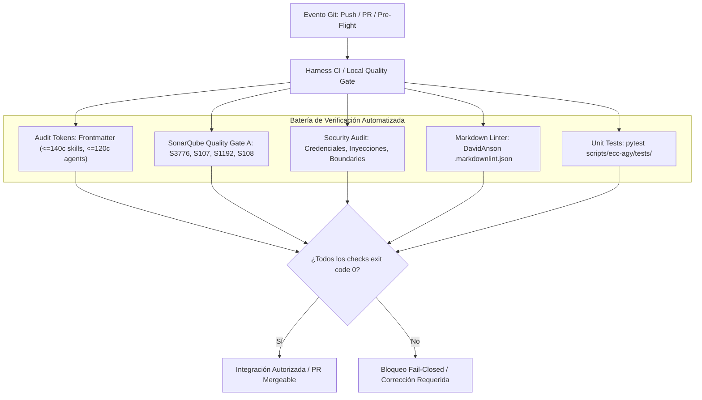

# Plan de Requisitos, Arquitectura, Seguridad y Análisis de Costes: Optimización de Tokens y Harness CI Quality Gate

> **Cumplimiento de Regla Global ECC-AGY**: Plan de Requisitos y Arquitectura previo a la implementación de las Tareas 2.1 y 2.2 de `doc/TODO.md` (Prioridad 2: Optimización de Tokens, Auditoría de Contexto y Calidad del Harness).

---

## 1. Contexto y Metadatos de la Petición

- **Proyecto / Módulo**: `ecc` (Universal Ecosystem Harness & Multi-distribution Plugin)
- **Tipo de Intervención**: Optimización de Tokens, Guardrails de Contexto, CI/CD Quality Gate y Scripts de Gobernanza
- **Fecha**: 2026-11-07
- **Objetivo Principal**: Implementar la auditoría y poda sistemática del consumo de tokens en contexto (skills $\le 140$ caracteres, agents $\le 120$ caracteres, modelo `flash`/`inherit`), unificar las herramientas de auditoría local (`workspace_audit.py`, `sonar_audit.py`, `security_audit.py` y wrappers) y desplegar el workflow de CI en GitHub Actions para validación estricta de ramas (`feat/*`, `fix/*`, `refactor/*`, `main`) con ejecución fail-closed de linters, tests unitarios y métricas SonarQube.

---

## 2. Toma de Requisitos Detallada y Criterios de Aceptación

### 2.1. Requisitos Funcionales (`RF`)

- **`RF-01` (Auditoría de Presupuesto de Tokens y Frontmatter)**:
  - Validar que todas las descripciones de skills en `skills/*/SKILL.md` y `ecc-agy/skills/*/SKILL.md` tengan una longitud máxima de 140 caracteres.
  - Validar que todas las descripciones de agentes en `agents/*.md` y `ecc-agy/agents/*.md` tengan una longitud máxima de 120 caracteres.
  - Enforzar que los agentes utilicen modelos óptimos (`flash` para exploración/diagnóstico/triage, `inherit` para razonamiento profundo).
  - Enforzar que los agentes con perfil de solo lectura (architect, reviewer, hunter, analyzer, planner) no contengan herramientas de mutación de archivos (`write_file`, `edit_file`, `replace_file_content`).
- **`RF-02` (Poda Sistemática y Optimización de Catálogo)**:
  - Refactorizar las descripciones sobrecargadas en el catálogo actual conservando las palabras clave canónicas de disparo.
  - Purgar archivos temporales, respaldos (`.bak`, `.tmp`, `.old`) y cachés residuales (`__pycache__`, `.pytest_cache`).
- **`RF-03` (Unificación de Herramientas de Auditoría Agnósticas)**:
  - Implementar en `scripts/ecc-agy/` los módulos deterministas en Python stdlib:
    - `workspace_audit.py`: Auditoría de 6 fases (Higiene, Budget de Tokens, Duplicados/Huérfanos, Consistencia de Reglas, Docs, SonarQube).
    - `sonar_audit.py`: Auditoría estática de reglas SonarQube (S3776 complejidad cognitiva $\le 15$, S107 parámetros $\le 7$, S1192 duplicados $\le 3$, S108 bloques vacíos).
    - `security_audit.py`: Escaneo estático de credenciales expuestas, comandos shell inseguros y boundary hardening.
  - Proveer wrappers ejecutables duales en `scripts/bin/ecc-agy/` (`.ps1` para Windows 11 pwsh y `.sh` POSIX LF para Linux/WSL).
- **`RF-04` (Workflow de CI/CD en GitHub Actions)**:
  - Configurar `.github/workflows/ci-quality-gate.yml` con disparadores para `push` a ramas `main`, `feat/**`, `fix/**`, `refactor/**`, `chore/**`, `infra/**` y eventos `pull_request` hacia `main`.
  - Pasos del pipeline:
    1. Checkout de código con historial completo.
    2. Configuración de Python 3.12/3.13 y Node.js.
    3. Validación de linter Markdown con `.markdownlint.json`.
    4. Ejecución de suite de tests unitarios (`python -m pytest scripts/ecc-agy/tests/`).
    5. Auditoría de presupuesto de tokens (`workspace_audit.py`).
    6. Auditoría estática SonarQube (`sonar_audit.py`).
    7. Auditoría estática de seguridad (`security_audit.py`).

### 2.2. Requisitos No Funcionales (`RNF`)

- **`RNF-01` (Eficiencia de Tokens)**: Reducción drástica del tamaño del catálogo cargado en contexto. Cumplimiento del 100% en frontmatter ($\le 140$c en skills, $\le 120$c en agentes).
- **`RNF-02` (Tiempo de CI / Fail-Closed)**: El pipeline completo en CI debe ejecutarse en menos de 2 minutos sin dependencias pesadas.
- **`RNF-03` (Cero Dependencias No Oficiales)**: Implementaciones en Python 3 puro (stdlib: `pathlib`, `re`, `argparse`, `dataclasses`, `collections`, `ast`) y pytest como único test-runner estándar.
- **`RNF-04` (Multiplataforma Windows / Linux)**: Compatibilidad garantizada para Windows 11 (pwsh) y Linux/Debian (POSIX LF `\n`).

### 2.3. Casos Límite (*Edge Cases*) y Condiciones de Fallo

- Skills con frontmatter multilínea o comillas escapadas: el parser debe normalizar y medir la longitud exacta del texto visible.
- Agentes sin frontmatter o con campos ausentes: detección y reporte como artefactos muertos/inválidos con código de salida $\ne 0$.
- Archivos `.md` de documentación técnica que contienen ejemplos de código: el linter Markdown y SonarQube deben ignorar bloques cercados de documentación sin falsos positivos.

### 2.4. Criterios de Aceptación (`CA`)

- [ ] **`CA-01`**: Suite de tests unitarios en `scripts/ecc-agy/tests/` cubre la auditoría de tokens, SonarQube y seguridad con exit code 0 y cobertura $\ge 80\%$.
- [ ] **`CA-02`**: El script `workspace_audit.py` y `audit-workspace.ps1` auditan el workspace y reportan 0 violaciones de longitud en skills y agentes tras la poda.
- [ ] **`CA-03`**: El script `sonar_audit.py` y `sonar-audit.ps1` superan la auditoría con calificación SonarQube A (complejidad cognitiva $\le 15$).
- [ ] **`CA-04`**: El script `security_audit.py` y `security-audit.ps1` se ejecutan limpiamente sin encontrar credenciales ni inyecciones.
- [ ] **`CA-05`**: El archivo `.github/workflows/ci-quality-gate.yml` está configurado con protección para ramas de tarea (`feat/*`, `fix/*`, `refactor/*`) y `main`.
- [ ] **`CA-06`**: Todos los archivos Markdown creados y modificados pasan el linter `lint-markdown.ps1` sin incidencias.

---

## 3. Auditoría de Reutilización y Retrocompatibilidad

### 3.1. Inventario de Activos Existentes a Reutilizar

- `scripts/ecc-agy/format_commit.py`: Módulo existente con validación y formateo de commits.
- `scripts/bin/ecc-agy/lint-markdown.ps1` / `.sh`: Linter canónico basado en `.markdownlint.json`.
- `scripts/bin/ecc-agy/git-flow-helper.ps1`: Automatización de ramas y llamadas a `audit-workspace.ps1`.
- `scripts/bin/ecc-agy/complete-task-pr.ps1`: Orquestador de finalización de tarea.
- Referencias base probadas en `C:\Workspace\projects\home-lab\scripts\plugin\ecc-agy\audit\`: Reutilizadas y adaptadas para ser completamente agnósticas de proyecto dentro de `ecc`.

### 3.2. Impacto en Contratos y Retrocompatibilidad

- **Contratos Afectados**: Cero cambios destructivos. Las modificaciones en frontmatter de skills y agents preservan 100% los nombres (`name`) y las palabras clave funcionales de disparo, reduciendo únicamente la verbosidad descriptiva.
- **Garantía de Retrocompatibilidad**: Compatible con cualquier arnés Antigravity / Gemini CLI / Claude Code que consuma el catálogo.
- **Plan de Rollback**: Reversión atómica mediante `git checkout` o `git revert` de la rama de tarea.

---

## 4. Arquitectura, Patrones de Diseño, Clean Code y Refactorización

### 4.1. Diseño Arquitectónico y Flujo de Datos

Ver diagrama persistido en [DGRM_ecc_token_optimization_and_ci_gate.mmd](file:///c:/Workspace/projects/ecc/doc/diagrams/DGRM_ecc_token_optimization_and_ci_gate.mmd).

### 4.2. Patrones de Diseño Aplicados

- **Strategy Pattern**: Estrategias de escaneo independientes por tipo de activo (Higiene, Tokens, Duplicados, SonarQube, Seguridad).
- **Template Method**: Pipeline secuencial de auditoría con salida estandarizada y propagación de código de salida.
- **Fail-Closed Gate**: Cualquier fallo en una comprobación aborta inmediatamente la elegibilidad de merge.

### 4.3. Clean Code e Inmutabilidad

- Modelos de datos inmutables con `@dataclass(frozen=True)`.
- Tipado estricto `from __future__ import annotations` en todo el código Python.
- Nombres de funciones explícitos y funciones con SRP ($\le 30$ líneas por función).

---

## 5. Seguridad, Vectores de Ataque, Robustez y Bastionado

### 5.1. Análisis de Amenazas

| Vector de Amenaza | Riesgo | Mitigación y Bastionado |
| :--- | :---: | :--- |
| **Ejecución arbitraria de comandos en scripts de auditoría** | Medio | Uso exclusivo de `subprocess.run` con lista de argumentos explícita (`shell=False`). |
| **Path Traversal en escaneo de archivos** | Bajo | Resolución canónica mediante `pathlib.Path.resolve()`. |
| **Fuga de secretos o tokens en catálogo de skills/agentes** | Alto | Regla de escaneo de secretos integrada en `security_audit.py`. |
| **Bypass de Quality Gate en ramas sin control** | Alto | Workflow en GitHub Actions ejecutando sobre `feat/*`, `fix/*`, `refactor/*` y `main`. |

---

## 6. Análisis de Costes de las Decisiones de Arquitectura

| Decisión Arquitectónica | Alternativa Descartada | Coste Visible | Coste Oculto |
| :--- | :--- | :--- | :--- |
| **Límites estrictos de frontmatter ($\le 140$c/$\le 120$c)** | Descripciones largas con párrafos explicativos | Esfuerzo de condensación inicial de las descripciones del catálogo | Cero. Aumenta drásticamente el presupuesto de tokens disponible para razonamiento activo. |
| **Scripts en Python stdlib pura** | Módulos pesados de terceros o herramientas externas | Implementación de parsers regex/AST propios | Máxima portabilidad, cero tiempo de instalación en CI, cero vulnerabilidades de dependencias. |
| **Fail-Closed CI Workflow** | Validaciones permisivas o manuales | Bloqueo de PRs con tests fallidos o linters rojos | Cero roturas en la rama principal `main`, preservando la regla de Trunk Verde. |

---

## 7. Plan de Implementación y Verificación (`TDD: RED -> GREEN -> REFACTOR`)

1. **Fase 1 (`RED`)**:
   - Crear tests unitarios en `scripts/ecc-agy/tests/test_workspace_audit.py`, `test_sonar_audit.py` y `test_security_audit.py`.
   - Confirmar que los tests fallan antes de disponer de la implementación.
2. **Fase 2 (`GREEN`)**:
   - Desarrollar `scripts/ecc-agy/workspace_audit.py`, `sonar_audit.py` y `security_audit.py`.
   - Crear wrappers en `scripts/bin/ecc-agy/` (`audit-workspace.ps1`, `audit-workspace.sh`, `sonar-audit.ps1`, `sonar-audit.sh`, `security-audit.ps1`, `security-audit.sh`).
   - Podar descripciones de skills y agentes que excedan los límites.
   - Crear el workflow `.github/workflows/ci-quality-gate.yml`.
   - Llevar todos los tests a verde.
3. **Fase 3 (`REFACTOR`)**:
   - Pulir ergonomía de mensajes y parámetros de CLI.
   - Formatear con linter Markdown todos los documentos tocados.
4. **Fase 4 (`VERIFY`)**:
   - Ejecutar la suite completa de pruebas unitarias (`python -m pytest`).
   - Ejecutar la auditoría de workspace (`audit-workspace.ps1`).
   - Ejecutar la auditoría SonarQube (`sonar-audit.ps1`).
   - Ejecutar la auditoría de seguridad (`security-audit.ps1`).
