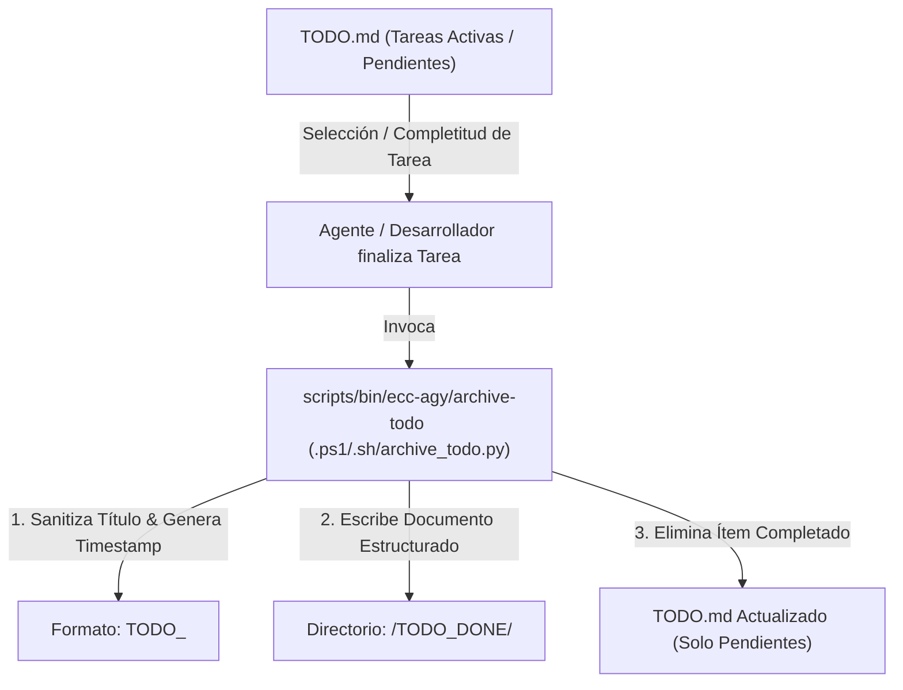

# Plan de Arquitectura y Requisitos: Ciclo de Vida de Tareas y Archivo de TODOs (`TODO_DONE`)

> **Referencia de Gobernanza**: Generado a partir de [`doc/TEMPLATE_REQUISITOS_ARQUITECTURA.md`](file:///C:/Workspace/projects/home-lab/doc/TEMPLATE_REQUISITOS_ARQUITECTURA.md) para dar cumplimiento a la regla obligatoria de análisis pre-implementación, gestión del ciclo de vida de tareas y archivo determinista de ítems completados.

---

## 1. Contexto y Metadatos de la Petición
- **Proyecto / Módulo**: `ecc-agy` / `scripts` (monorepo `home-lab`)
- **Tipo de Intervención**: Nueva Funcionalidad, Automatización y Reglas de Gobernanza
- **Fecha**: 2026-10-25
- **Objetivo Principal**: Implementar una regla global y el ecosistema completo (regla `AGENTS.md`, script en `scripts/bin/ecc-agy/`, skill `todo-lifecycle` y subagente `todo-archiver`) para que cada vez que se complete un ítem de tareas (`TODO`), se elimine del archivo principal (`TODO.md`) y se archive automáticamente en `/TODO_DONE/TODO_<title>_TS.md`.

---

## 2. Toma de Requisitos Detallada y Criterios de Aceptación

### 2.1. Requisitos Funcionales (`RF`)
- **`RF-01` (Detección y Extracción de Ítems)**: El sistema debe identificar ítems completados (sintaxis Markdown `- [x] <título>`, `- [X]`, cabeceras de tarea o argumentos explícitos CLI) en el archivo principal `TODO.md` (o archivo de tareas especificado).
- **`RF-02` (Eliminación Limpia del Archivo Principal)**: Al archivar una tarea completada, esta debe removerse limpiamente de `TODO.md` (evitando dejar bloques residuales vacíos o saltos de línea huérfanos), manteniendo `TODO.md` estrictamente para tareas activas o pendientes (`- [ ]`).
- **`RF-03` (Generación de Archivo en `/TODO_DONE/`)**: El ítem completado debe persistirse en el directorio `TODO_DONE/` (creándolo si no existe) bajo el patrón de nomenclatura canónico `TODO_<title>_<timestamp>.md`:
  - `<title>`: Título normalizado en formato slug seguro (alfanumérico en mayúsculas/minúsculas o separado por guiones bajos, sin caracteres especiales ni espacios).
  - `<timestamp>`: Marca temporal de completitud `YYYYMMDD_HHMMSS` (ej. `20261025_014500`).
- **`RF-04` (Estructura del Archivo Archivado)**: El documento generado en `TODO_DONE/` debe registrar:
  - Metadatos YAML frontmatter / cabecera (título, timestamp ISO, estado `COMPLETED`, autor/agente ejecutor).
  - Descripción original del ítem y alcance.
  - Verificación y pruebas ejecutadas (criterios de aceptación satisfechos).
  - Entregables y cambios aplicados (archivos modificados, commits o módulos).
- **`RF-05` (Invocación Determinista por Script y Agente)**: Debe proporcionarse una herramienta CLI en Python (`scripts/ecc-agy/archive_todo.py`) y wrappers estándar (`scripts/bin/ecc-agy/archive-todo.ps1` y `archive-todo.sh`), además de una skill (`skills/todo-lifecycle/SKILL.md`) y un subagente (`agents/todo-archiver.md`).

### 2.2. Requisitos No Funcionales (`RNF`)
- **`RNF-01` (Cero Dependencias Externas)**: Implementación en Python 3 utilizando exclusivamente la biblioteca estándar (`argparse`, `dataclasses`, `datetime`, `pathlib`, `re`, `sys`).
- **`RNF-02` (Idempotencia y Atomicidad)**: La operación de archivo y edición de `TODO.md` debe ser atómica (escritura en destino y actualización limpia del origen sin pérdida de información si ocurre un error).
- **`RNF-03` (Eficiencia de Tokens)**:
  - Skill frontmatter `description` $\le 140$ caracteres.
  - Subagente frontmatter `description` $\le 120$ caracteres, modelo `flash`, herramientas con permisos de mínimo privilegio.

### 2.3. Casos Límite (*Edge Cases*) y Condiciones de Fallo
- **Título con caracteres no seguros para sistemas de archivos** (ej. `:`, `/`, `\`, `?`, `*`, comillas, tildes): Sanitización a caracteres seguros `[A-Za-z0-9_-]`.
- **`TODO.md` inexistente o vacío**: Mensaje de aviso claro y código de salida apropiado sin lanzar trazas no controladas.
- **Múltiples tareas completadas en una sola pasada**: Opción `--all-completed` para procesar y archivar secuencialmente todos los ítems marcados con `- [x]`.
- **Nombre de tarea duplicado**: La inclusión del timestamp preciso (`_YYYYMMDD_HHMMSS`) previene colisiones de nombres.

### 2.4. Criterios de Aceptación (`CA`)
- [ ] **`CA-01`**: Ejecutar `python scripts/ecc-agy/archive_todo.py --todo TODO.md --complete "Tarea Ejemplo"` extrae la tarea de `TODO.md` y genera `TODO_DONE/TODO_Tarea_Ejemplo_<timestamp>.md`.
- [ ] **`CA-02`**: Ejecutar el script con `--all-completed` archiva todas las tareas con `- [x]` y deja en `TODO.md` únicamente las pendientes (`- [ ]`).
- [ ] **`CA-03`**: El wrapper `scripts/bin/ecc-agy/archive-todo.ps1` funciona en Windows 11 (`pwsh`) y `archive-todo.sh` en Debian/Linux (POSIX LF).
- [ ] **`CA-04`**: La regla está sincronizada en `~/.gemini/config/plugins/ecc-agy/rules/AGENTS.md`, `ecc-agy/AGENTS.md` y `ecc-agy/.gemini/GEMINI.md`.
- [ ] **`CA-05`**: `workspace-audit.py` y `sonar-audit.py` pasan con 0 violaciones y calidad A.

---

## 3. Auditoría de Reutilización y Retrocompatibilidad

### 3.1. Inventario de Activos Existentes a Reutilizar
- **Pipeline de Auditoría y Scripts**: [`scripts/bin/ecc-agy/`](file:///C:/Workspace/projects/home-lab/scripts/bin/ecc-agy/) y [`scripts/ecc-agy/workspace-audit.py`](file:///C:/Workspace/projects/home-lab/scripts/ecc-agy/workspace-audit.py) para verificación continua de higiene.
- **Estructura de Scripts Multi-OS**: Patrón establecido en [`doc/scripts/README.md`](file:///C:/Workspace/projects/home-lab/doc/scripts/README.md) con wrappers `.ps1` y `.sh`.

### 3.2. Impacto en Contratos y Estrategia de Retrocompatibilidad
- **Contratos Afectados**: Ninguno. La regla es puramente aditiva y no rompe ningún formato de archivos existentes.
- **Retrocompatibilidad**: Si un proyecto no dispone de `TODO.md`, las herramientas simplemente no se ejecutan o crean la estructura bajo demanda.

---

## 4. Arquitectura, Patrones de Diseño, Clean Code y Refactorización

### 4.1. Flujo de Datos del Ciclo de Vida de Tareas
El flujo operativo completo está diagramado y persistido en [`doc/ecc-agy/diagrama/todo_lifecycle_pipeline.mmd`](file:///C:/Workspace/projects/home-lab/doc/ecc-agy/diagrama/todo_lifecycle_pipeline.mmd):

### 4.2. Patrones de Diseño Aplicados
- **Command / CLI Strategy**: Separación entre la lógica de negocio en `archive_todo.py` y los adaptadores de shell específicos (`.ps1`, `.sh`).
- **Immutable Value Objects**: Clases `@dataclass(frozen=True)` para representar las tareas (`TodoItem`) y los resultados de archivo (`ArchiveResult`).
- **Sanitizer Pipeline**: Transformación de texto libre a slug canónico sin efectos secundarios.

### 4.3. Principios Clean Code y Usabilidad (UX / DX)
- **UX / DX Ergonomía**: El comando permite tanto especificar el título por parámetro CLI como procesar automáticamente todas las tareas completadas (`--all-completed`), facilitando flujos desatendidos.
- **Legibilidad y Mantenibilidad**: Funciones de menos de 40 líneas con tipado estricto (`Path`, `Optional`, `List[TodoItem]`), `logging` estándar y cero variables mágicas.

---

## 5. Seguridad, Vectores de Ataque, Robustez y Bastionado

### 5.1. Modelado de Amenazas y Vectores de Ataque
| Vector de Ataque / Riesgo | Severidad | Mitigación y Bastionado Aplicado |
| :--- | :---: | :--- |
| **Path Traversal / Inyección de Nombres de Archivo** | Alta | Sanitización estricta del título (`re.sub(r'[^A-Za-z0-9_-]', '_', title)`) y validación de que la ruta resuelta permanezca dentro del directorio `TODO_DONE`. |
| **Pérdida de Datos en `TODO.md`** | Alta | Lectura completa en memoria, escritura primero del archivo en `TODO_DONE/` y actualización segura de `TODO.md` solo tras confirmación de persistencia del archivo archivado. |
| **Inyección de Comandos en Wrappers Shell** | Media | Paso de parámetros mediante arrays de argumentos en PowerShell (`@ArgsList`) y Bash (`"${ARGS[@]}"`), sin interpolación directa de cadenas. |

---

## 6. Análisis de Costes de las Decisiones de Arquitectura (Visibles y Ocultos)

| Decisión Arquitectónica | Alternativa Descartada | Coste Visible (Directo) | Coste Oculto (Indirecto / Largo Plazo) |
| :--- | :--- | :--- | :--- |
| **Archivar en archivos individuales `/TODO_DONE/TODO_<title>_TS.md`** | Mantener un único archivo histórico acumulativo `TODO_DONE.md` | Mayor número de archivos en el sistema de ficheros. | **Muy bajo**: Previene conflictos de merge en Git en archivos históricos únicos concurrentes, facilita la búsqueda por título/fecha y mantiene `TODO.md` 100% ligero. |
| **Script Python stdlib pura en `scripts/ecc-agy/` con wrappers en `scripts/bin/`** | Script inline en PowerShell o JavaScript Node.js | Crear 3 archivos (`archive_todo.py`, `.ps1`, `.sh`). | **Cero deuda**: Sigue el estándar monorepo 100% Python, funciona idéntico en Windows y Linux, y no requiere `npm install` ni paquetes externos. |
| **Skill lazy-load y Subagente `flash`** | Regla monolítica en `AGENTS.md` con todo el tutorial | Creación de `SKILL.md` y `agents/todo-archiver.md`. | **Ahorro de tokens**: Solo consume tokens cuando se invoca la tarea de archivo, manteniendo el prompt base limpio. |

---

## 7. Plan de Implementación y Verificación (`TDD: RED -> GREEN -> REFACTOR`)

1. **Fase 1 — Diagrama Mermaid**: Persistir `todo_lifecycle_pipeline.mmd` en `doc/ecc-agy/diagrama/`.
2. **Fase 2 — Script Determinista en Python (`archive_todo.py`)**: Implementar en `scripts/ecc-agy/archive_todo.py` con tests asociados.
3. **Fase 3 — Wrappers Multi-OS**: Crear `scripts/bin/ecc-agy/archive-todo.ps1` y `archive-todo.sh`.
4. **Fase 4 — Skill y Subagente en `ecc-agy`**: Crear `skills/todo-lifecycle/SKILL.md` y `agents/todo-archiver.md` y sincronizar en el plugin global.
5. **Fase 5 — Reglas del Sistema**: Registrar la regla en `AGENTS.md` (global, monorepo y Gemini).
6. **Fase 6 — Verificación Integral**: Ejecutar `audit-workspace.ps1` y verificar 0 fallos de higiene, tokens, gobernanza y SonarQube.
