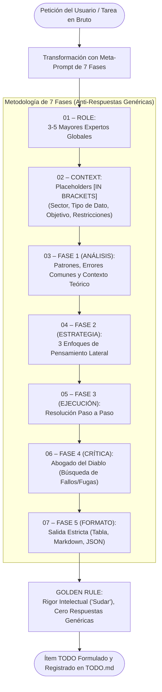

# Plan de Arquitectura y Requisitos: Regla de Transformación de Peticiones y Tareas de TODO (Meta-Prompt de 7 Fases)

> **Cumplimiento de Regla Global ECC-AGY**: Planificación técnica detallada previa a la incorporación de la regla mandatoria para transformar toda petición de usuario e ítem de `TODO.md` mediante la metodología de prompting de alta exigencia intelectual (7 fases).

---

## 1. Contexto y Metadatos de la Petición

- **Proyecto / Módulo**: `ecc-agy` (plugin global) / `scripts` (monorepo `home-lab`)
- **Tipo de Intervención**: Nueva Regla de Gobernanza, Extensión de Skill y Herramienta de Transformación de Prompts
- **Fecha**: 2026-10-25
- **Objetivo Principal**: Integrar como regla obligatoria que todos los puntos de `TODO.md` y peticiones de tareas apliquen una transformación rigurosa basada en el meta-prompt de 7 fases (Rol de expertos, Contexto con placeholders, Análisis previo, 3 enfoques laterales, Ejecución paso a paso, Abogado del diablo y Formato estricto) bajo la Golden Rule de forzar al modelo a "sudar" intelectualmente y erradicar respuestas genéricas.

---

## 2. Toma de Requisitos Detallada y Criterios de Aceptación

### 2.1. Requisitos Funcionales (`RF`)

- **`RF-01` (Formalización de la Regla en `AGENTS.md` y `GEMINI.md`)**:
  - Incorporar la directiva en las reglas globales: ante la formulación, refinamiento o incorporación de cualquier punto en `TODO.md` (o análisis pre-implementación de una petición), aplicar la transformación con la estructura canónica:
    1. `01 – ROLE`: Combinar los 3-5 mayores expertos mundiales en la materia.
    2. `02 – CONTEXT`: Placeholders `[ENTRE CORCHETES]` (Sector, Tipo de Dato, Objetivo, Restricciones).
    3. `03 – FASE 1 (ANÁLISIS)`: Análisis forzado previo a la solución (patrones, fallos típicos, fundamentos teóricos).
    4. `04 – FASE 2 (ESTRATEGIA)`: Proponer 3 enfoques distintos de pensamiento lateral antes de elegir el mejor.
    5. `05 – FASE 3 (EJECUCIÓN)`: Resolución paso a paso, granular y determinista.
    6. `06 – FASE 4 (CRÍTICA)`: Rol de "Abogado del Diablo" buscando fallas, vulnerabilidades y debilidades de la solución propuesta.
    7. `07 – FASE 5 (FORMATO)`: Definición estricta del artefacto de salida (Tablas, código Markdown, JSON, etc.).
    - `GOLDEN RULE`: El prompt/tarea debe ser exigente, sin respuestas genéricas ni atajos superficiales.
- **`RF-02` (Herramienta CLI de Transformación — `transform_todo.py`)**:
  - Implementar `scripts/ecc-agy/transform_todo.py` y wrappers `transform-todo.ps1` y `transform-todo.sh`.
  - Capacidad de recibir una tarea o petición y generar automáticamente el andamio completo de las 7 fases con placeholders y personalidades de expertos asociadas al dominio.
- **`RF-03` (Actualización de Skill `todo-lifecycle`)**:
  - Sincronizar [`skills/todo-lifecycle/SKILL.md`](file:///C:/Workspace/projects/home-lab/skills/todo-lifecycle/SKILL.md) preservando frontmatter $\le 140$ caracteres y documentando el flujo de transformación de tareas previo a su incorporación o ejecución.
- **`RF-04` (Suites de Test y Calidad SonarQube)**:
  - Tests unitarios en `scripts/ecc-agy/tests/test_transform_todo.py` con cobertura de casos límite.
  - Complejidad cognitiva $\le 15$ (`S3776`), tipado estricto y sin dependencias no oficiales.

### 2.2. Requisitos No Funcionales (`RNF`)

- **`RNF-01` (Eficiencia de Tokens)**:
  - Skill description $\le 140$ caracteres.
  - Agentes description $\le 120$ caracteres.
  - Redacción concisa de la regla sin sacrificar completitud de directivas.
- **`RNF-02` (Determinismo e Idempotencia)**:
  - La transformación CLI produce plantillas coherentes y rellenables sin efectos colaterales destructivos.

### 2.3. Criterios de Aceptación (`CA`)

- [ ] **`CA-01`**: La regla está redactada y sincronizada en `~/.gemini/config/plugins/ecc-agy/rules/AGENTS.md`, `ecc-agy/rules/AGENTS.md`, `ecc-agy/AGENTS.md` y `ecc-agy/.gemini/GEMINI.md`.
- [ ] **`CA-02`**: El script `transform_todo.py` y sus wrappers funcionan en Windows y Linux produciendo las 7 fases requeridas.
- [ ] **`CA-03`**: La suite `test_transform_todo.py` supera el 100% de las pruebas unitarias.
- [ ] **`CA-04`**: `audit-workspace.ps1 -Clean` aprueba las 4 fases con 0 alertas y Quality Gate en verde.

---

## 3. Arquitectura y Flujo de Transformación

---

## 4. Análisis de Costes de la Decisión Arquitectónica

### 4.1. Costes Visibles
- **Esfuerzo de Implementación**: ~15 minutos.
- **Uso de Tokens**: Aumento controlado de tokens en la fase de formulación de tareas a cambio de una precisión técnica drásticamente superior.

### 4.2. Costes Ocultos
- **Mitigación de Deuda Técnica**: Erradica retrabajos causados por especificaciones ambiguas o respuestas preliminares superficiales del asistente.
