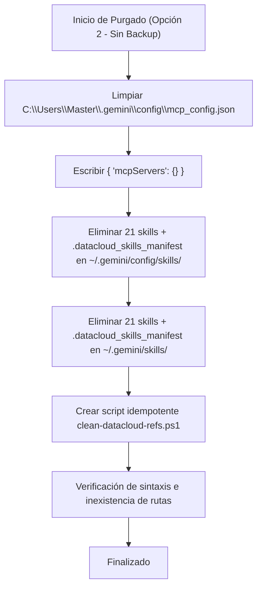

# Requisitos y Arquitectura: Saneamiento Completo de `googlecloudtools.datacloud` (Opción 2 - Sin Backups)

## 1. Contexto y Metadatos de la Petición

- **Proyecto / Módulo**: `ecc-agy` (Configuración de entorno AGY / Antigravity CLI / IDE)
- **Tipo de Intervención**: `Corrección de Bug / Saneamiento de Configuración`
- **Fecha**: 2026-10-24
- **Objetivo Principal**: Desinstalar por completo y purgar todas las referencias huérfanas de `googlecloudtools.datacloud`: eliminar los 3 servidores MCP fallidos en `mcp_config.json`, así como el manifiesto `.datacloud_skills_manifest` y las 21 carpetas de skills asociadas en `~/.gemini/config/skills` y `~/.gemini/skills`, sin generar archivos de copia de seguridad adicionales (por instrucción explícita del usuario).

---

## 2. Toma de Requisitos Detallada y Criterios de Aceptación

### 2.1. Requisitos Funcionales (`RF`)

- **`RF-01`**: Limpiar `C:\Users\Master\.gemini\config\mcp_config.json` eliminando los servidores MCP huérfanos (`notebooks`, `visualization`, `data-agent-kit`) que apuntan a la ruta inexistente de la extensión eliminada `c:\Users\Master\.antigravity-ide\extensions\googlecloudtools.datacloud-1.1.2-universal\mcp_servers\cli\mcp_proxy_bundle.js`.
- **`RF-02`**: Preservar la validez de `mcp_config.json` dejándolo como `{ "mcpServers": {} }`.
- **`RF-03`**: Eliminar directamente sin crear archivos de backup (`.bak` ni carpetas temporales de backup) según requerimiento explícito del usuario.
- **`RF-04`**: Eliminar el manifiesto `.datacloud_skills_manifest` y las 21 carpetas de skills de Data Cloud huérfanas en `C:\Users\Master\.gemini\config\skills\` y `C:\Users\Master\.gemini\skills\`.
- **`RF-05`**: Crear el script PowerShell idempotente `C:\Workspace\projects\home-lab\scripts\bin\ecc-agy\clean-datacloud-refs.ps1` para auditoría y saneamiento repetible de referencias rotas en el workspace.

### 2.2. Requisitos No Funcionales (`RNF`)

- **Rendimiento y Arranque**: Eliminación inmediata de las trazas de error de Node.js (`MODULE_NOT_FOUND`) y de la sobrecarga de 3 subprocesos fallidos al iniciar sesión o invocar herramientas.
- **Higiene del Workspace**: Purgado total de skills huérfanos no deseados del catálogo disponible para el modelo.

### 2.3. Criterios de Aceptación (`CA`)

- [ ] **`CA-01`**: `C:\Users\Master\.gemini\config\mcp_config.json` parsea a JSON válido y no contiene referencias a `googlecloudtools.datacloud`.
- [ ] **`CA-02`**: Ninguno de los 21 directorios de skills de Data Cloud ni `.datacloud_skills_manifest` existen en `C:\Users\Master\.gemini\config\skills\` ni en `C:\Users\Master\.gemini\skills\`.
- [ ] **`CA-03`**: No se han creado archivos `.bak` ni carpetas `.backup_*`.
- [ ] **`CA-04`**: El script `clean-datacloud-refs.ps1` ejecuta de forma idempotente con salida limpia.

---

## 3. Inventario de Activos a Purgar

### 3.1. Servidores MCP en `mcp_config.json`

- `notebooks`
- `visualization`
- `data-agent-kit`

### 3.2. Manifiestos y Skills (21 carpetas en ambos directorios: `config\skills` y `skills`)

1. `.datacloud_skills_manifest`
2. `accidental-data-loss-prevention`
3. `bigquery-data-transfer-service`
4. `bigquery-sql`
5. `building-data-apps`
6. `data-autocleaning`
7. `dataform-bigquery`
8. `dbt-bigquery`
9. `discovering-gcp-data-assets`
10. `enforcing-resource-attribution`
11. `gcp-data-pipelines`
12. `gcp-dataflow`
13. `gcp-pipeline-orchestration`
14. `gcp-pipeline-resource-provisioning`
15. `gcp-spark`
16. `gcp-spark-troubleshooting`
17. `google-cloud-auth-verification`
18. `managing-python-dependencies`
19. `ml-best-practices`
20. `notebook-guidance`
21. `schema-mapping`
22. `skill-repair`

---

## 4. Arquitectura y Flujo de Ejecución

---

## 5. Análisis de Costes

| Decisión | Coste Visible | Coste Oculto |
| :--- | :--- | :--- |
| **Limpieza Nivel 2 directa (sin backup)** | Inmediata eliminación de ~1.5 MB de archivos y 21 skills no utilizados | Se pierde la documentación offline de BigQuery/Spark provista por los skills (reemplazable por el plugin oficial de documentación `google-developer-knowledge` ya instalado) |
