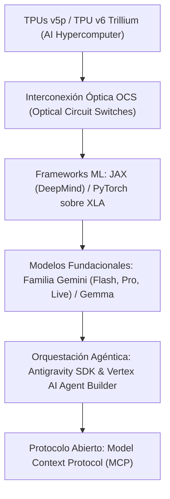

# Arquitectura y Stack Tecnológico Moderno de Google

Este documento sintetiza la pila tecnológica y los estándares de ingeniería que vertebran los sistemas de **Google**, distinguiendo entre su **plataforma interna de ingeniería** (donde operan Google Search, YouTube, Workspace y DeepMind) y su **ecosistema público** para desarrolladores y Google Cloud.

---

## 1. Núcleo de Lenguajes Oficiales (*The Google Languages*)

Google mantiene una gobernanza rigurosa sobre los lenguajes permitidos para desarrollo a escala de producción, cada uno con guías de estilo canónicas y certificaciones internas de legibilidad (*Readability*):

| Lenguaje | Ámbitos de Aplicación Primarios | Estado y Tendencia Actual en Google |
| :--- | :--- | :--- |
| **Rust** | Componentes de bajo nivel, SO (Android), hipervisores, redes y firmware. | **Prioridad Estratégica #1:** Reemplazando progresivamente a C++ en nuevos desarrollos donde la seguridad de memoria es crítica. Google ha reportado formalmente cero vulnerabilidades de memoria en su nuevo código en Rust. |
| **Go (Golang)** | Infraestructura cloud, microservicios backend, proxies, herramientas CLI y Kubernetes. | **Estándar de facto:** Diseñado originalmente en Google para concurrencia masiva y compilaciones ultrarrápidas en redes distribuidas. |
| **C++ (C++20/C++23)** | Motor de búsqueda (Search), indexación, motor Chromium, controladores de TPU y procesado de vídeo en YouTube. | **Rendimiento crítico:** Columna vertebral de los sistemas con requisitos de latencia sub-milisegundo y optimización extrema de memoria. |
| **Java (Java 21/25)** | Grandes capas de negocio empresariales, servicios de Google Cloud y procesamiento de datos. | **Plataforma robusta:** Extensamente utilizado en infraestructura backend madura, respaldado por compiladores optimizados y herramientas de análisis estático propias. |
| **Python** | Investigación en IA (Google DeepMind), orquestación de datos y scripts de automatización. | **IA y ML:** Dominante en ciencia de datos, exigiendo tipado estricto (`pytype`, `mypy`, Pydantic) para entornos de producción. |
| **TypeScript** | Todo el desarrollo frontend, consolas web y extensiones/herramientas de desarrollo. | **Estándar universal:** Prácticamente el 100% del código web se compila desde TypeScript hacia JavaScript optimizado. |
| **Kotlin & Dart** | Android (Kotlin + Jetpack Compose) y aplicaciones multiplataforma (Dart + Flutter). | **Movilidad y UI:** Kotlin es el lenguaje *first-class* para Android; Dart y Flutter sustentan productos como Google Pay y Google Earth. |

---

## 2. Infraestructura de Inteligencia Artificial y Machine Learning

La modernización técnica más profunda de Google gira en torno al entrenamiento, inferencia y orquestación de modelos multimodales:

### 2.1 Hardware: TPUs y el AI Hypercomputer

* **TPU v5p y TPU v6 (Trillium)**: Circuitos integrados (ASIC) diseñados específicamente para operaciones matriciales con alta eficiencia energética por vatio.
* **Optical Circuit Switching (OCS)**: Conmutación óptica dinámica de la topología de red para reconfigurar superordenadores de IA al vuelo sin cuellos de botella de red convencionales.

### 2.2 Frameworks y Compilación

* **JAX**: El framework preferido por **Google DeepMind** para investigación frontera. Su arquitectura desacoplada permite transformaciones funcionales puras (`grad`, `jit`, `vmap`, `pmap`) compiladas a código nativo mediante **XLA** (*Accelerated Linear Algebra*).
* **OpenXLA**: Motor de compilación que optimiza grafos de ML tanto para TPUs como para GPUs.

### 2.3 Modelos e IA Agéntica

* **Familia Gemini**: Arquitectura nativamente multimodal (texto, código, visión, audio bidireccional en tiempo real con Gemini Live).
* **Gemma**: Modelos abiertos ligeros construidos a partir de la misma tecnología que Gemini.
* **Google Antigravity SDK & Vertex AI**: Plataforma para agentes autónomos con memoria persistente, subagentes especializados y adopción del estándar **Model Context Protocol (MCP)**.

---

## 3. Frontend y la Gran Convergencia Web: Angular + Wiz

En el ámbito web, Google ha protagonizado uno de los movimientos arquitectónicos más notorios de la industria al unificar sus dos grandes iniciativas de frontend:

### 3.1 La Convergencia de los Dos Mundos

1. **Wiz**: Framework interno propietario optimizado para carga diferida extrema y renderizado en servidor (SSR), utilizado en productos con miles de millones de usuarios simultáneos (Google Search, YouTube, Google Photos).
2. **Angular**: Framework público de grado corporativo enfocado en aplicaciones ricas y paneles interactivos complejos (Google Cloud Console, Firebase, Google Ads).

### 3.2 El Resultado Moderno

* **Reactividad basada en Signals**: La adopción de señales atómicas (*Signals*) en Angular es fruto directo de la integración de la reactividad eficiente de Wiz.
* **Control Flow Nativo y Deferrable Views**: Sustitución de directivas pesadas por bloques nativos de compilación (`@if`, `@for`, `@defer`) para hidratación diferida y progresiva.
* **Lit (Web Components)**: Librería ligera mantenida por Google para crear componentes web basados en estándares W3C, reutilizables en cualquier stack sin acoplamiento a frameworks.
* **Material Design 3 (M3 Expressive)**: Sistema de diseño unificado que adapta tipografías, tokens de color HSL y micro-interacciones adaptativas en web y móvil.

---

## 4. Sistemas Distribuidos, Redes y Persistencia

La computación en Google no se concibe sobre servidores o VMs individuales, sino sobre un sustrato distribuido planetario:

* **Orquestación de Contenedores**:
  * **Borg**: El sistema operativo de clústeres interno de Google que gestiona millones de contenedores diarios y sirvió como base teórica y práctica para crear **Kubernetes**.
  * **GKE & Cloud Run**: Soluciones cloud nativas y serverless para el despliegue moderno de microservicios y APIs.
* **Comunicación Inter-Servicio**:
  * **gRPC + Protocol Buffers (Protobuf v3/v4)**: Prácticamente el 100% del tráfico interno se transmite en binario fuertemente tipado mediante llamadas RPC sobre HTTP/2 y QUIC (HTTP/3).
* **Almacenamiento y Bases de Datos**:
  * **Google Spanner**: Base de datos relacional globalmente distribuida con consistencia ACID estricta gracias a **TrueTime** (sincronización con relojes atómicos y GPS en cada datacenter).
  * **Bigtable**: Almacén NoSQL masivo para acceso clave-valor y analítica de alta concurrencia.
  * **Colossus**: Sistema de archivos distribuido de última generación (sucesor de GFS), base del almacenamiento de YouTube, Drive y Cloud Storage.
  * **BigQuery**: Motor analítico SQL distribuido a escala de petabytes basado en la tecnología **Dremel**.

---

## 5. Tooling y Experiencia de Desarrollo Interna (*Developer Experience*)

La ingeniería dentro de Google sigue principios únicos de escala y automatización:

* **El Monorepo ("Piper")**:
  * La inmensa mayoría del código fuente de Google vive en un único repositorio colosal de cientos de millones de líneas.
  * Garantiza atomicidad en refactorizaciones de librerías globales sin problemas de infierno de dependencias entre versiones (*diamond dependency problem*).
* **Sistema de Compilación: Blaze (Bazel)**:
  * Sistema de compilación distribuido, reproducible, hermético y basado en grafos dirigidos acíclicos (DAG). La versión de código abierto es **Bazel**.
* **Entornos en la Nube y Asistencia Agéntica**:
  * **Cider**: Entorno de desarrollo basado en navegador conectado a contenedores efímeros en centros de datos.
  * **Antigravity IDE & AI Pair Programming**: Herramientas integradas en el IDE que orquestan agentes autónomos para análisis de dependencias, refactorización masiva y generación automatizada de tests (TDD).
* **Revisión de Código y Calidad**:
  * **Critique**: Plataforma interna de Code Review con políticas estrictas de aprobación por propietarios de módulo (`OWNERS`) y certificación de estilo (`Readability`).
  * **Tricorder**: Analizador estático automatizado que ejecuta verificaciones de seguridad, linters y análisis semántico en cada *Changelist* (CL).

---

## 6. Cuadro Resumen: Stack Tradicional vs. Stack Moderno

| Dimensión | Enfoque Tradicional / Legado | Enfoque Moderno Actual en Google |
| :--- | :--- | :--- |
| **Sistemas Críticos** | C++ intensivo | **Rust** para código nuevo de bajo nivel; **C++20/23** optimizado |
| **Machine Learning** | TensorFlow estático | **JAX** (DeepMind) + **PyTorch/XLA** + **Gemini Multimodal** |
| **Hardware IA** | GPUs genéricas / CPUs | **TPUs v5p / v6 Trillium** interconectadas vía **OCS** |
| **Frontend Web** | Angular clásico (Zone.js) / Wiz aislado | **Angular + Wiz** convergente (Signals, `@defer`, Lit, M3) |
| **Microservicios** | Java clásico / C++ RPC | **Go** + **gRPC / Protobuf v4** + **Cloud Run / GKE** |
| **Bases de Datos** | Sharding manual de MySQL | **Google Spanner** (TrueTime) + **Bigtable** + **BigQuery** |
| **Desarrollo** | Workstations locales pesadas | **Cider / Antigravity IDE** (Cloud containers + Agentes IA) |
