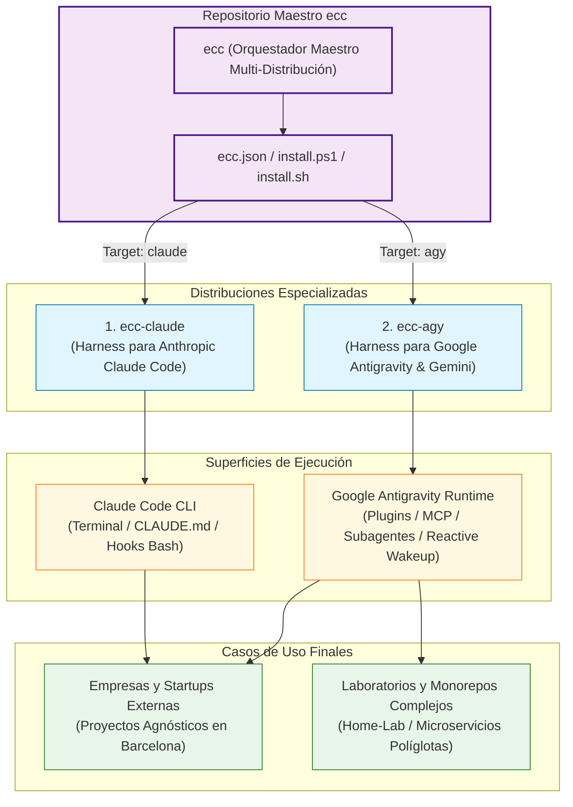
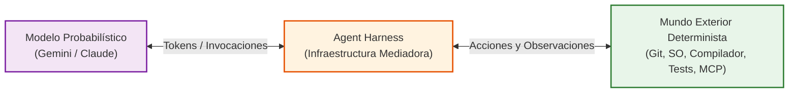
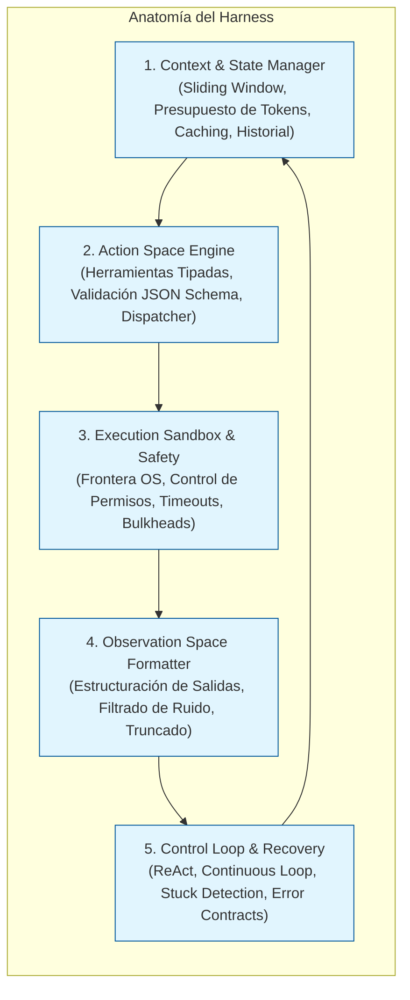
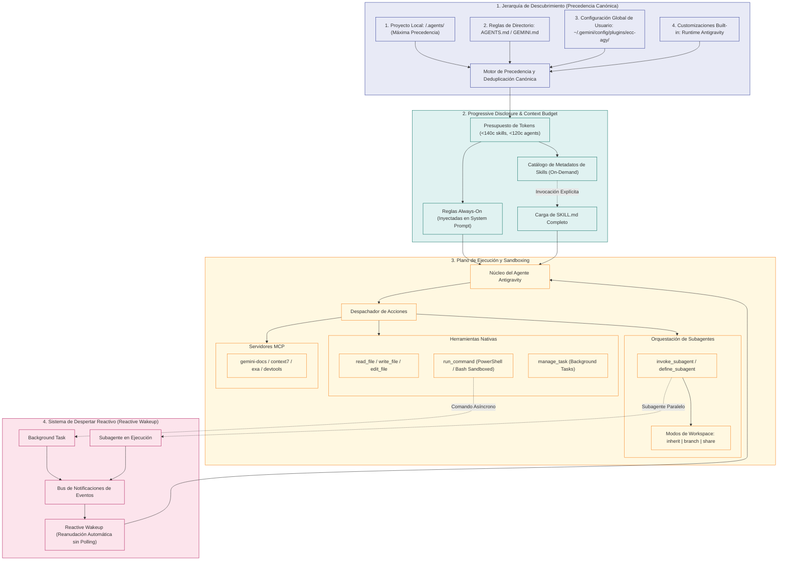
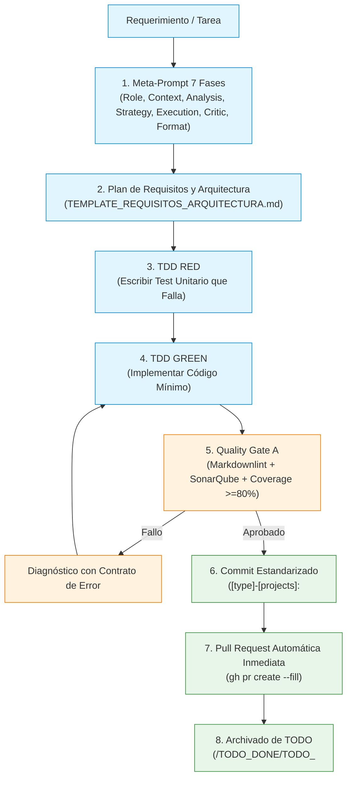
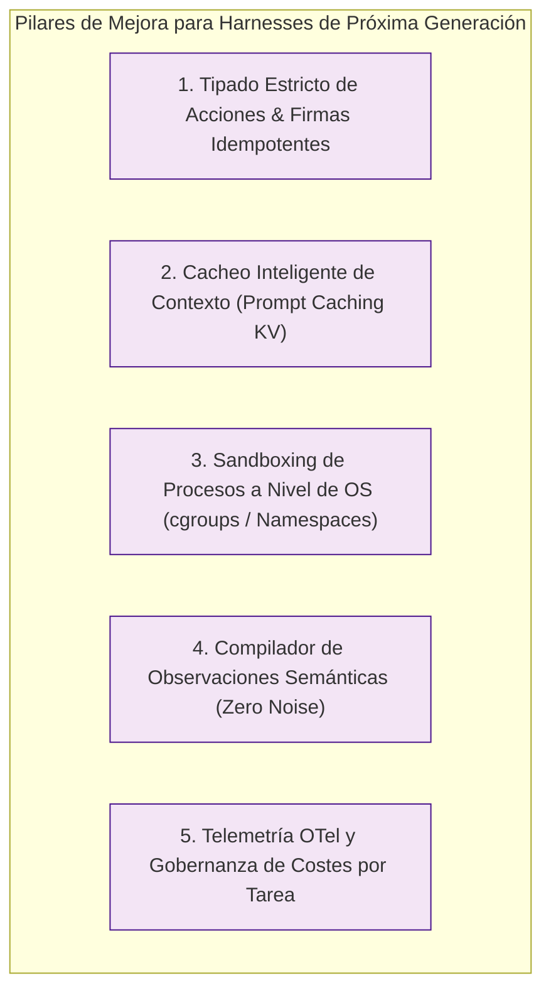

# Guía Maestra de Arquitectura de Harnesses y Entorno Google Antigravity (`ecc`)

> **Documento de Arquitectura, Manual de Referencia y Especificación Técnica**  
> Repositorio: [`ACB75/ecc`](https://github.com/ACB75/ecc)  
> Versión del Ecosistema: `3.0.0` | Fecha: 2026-11-01  
> Clasificación: Ingeniería de Agentes Autónomos & Runtimes de IA

---

## 1. Visión General del Ecosistema Multi-Harness `ecc`

El proyecto `ecc` (Everything Claude Code / Antigravity Master Ecosystem) representa una plataforma de ingeniería avanzada diseñada para orquestar, estandarizar y ejecutar agentes autónomos de inteligencia artificial sobre múltiples motores de inferencia y entornos de desarrollo.

Históricamente, las configuraciones de agentes de codificación estaban rígidamente acopladas a una única herramienta (por ejemplo, el CLI de Claude Code). El ecosistema `ecc` resuelve este acoplamiento introduciendo una **Arquitectura Multi-Harness Desacoplada**, permitiendo que las mismas reglas de ingeniería de nivel industrial (los 5 Pilares de Google, TDD riguroso, SonarQube Rating A, SRE Baseline y Trunk-Based PRs) se ejecuten con idéntica fiabilidad tanto en entornos de terminal como en runtimes agénticos integrados.



### 1.1. Distribuciones Integradas

1. **`ecc-claude`**:
   - **Motor**: Anthropic Claude Code CLI.
   - **Artefactos**: [`CLAUDE.md`](file:///c:/Workspace/projects/ecc/ecc-claude/CLAUDE.md), directiva `.claude/`, hooks de ciclo de vida en Python/Bash y comandos slash (`/plan`, `/review`, `/prp-*`).
   - **Paradigma**: Ejecución secuencial interactiva en terminal con captura directa de flujos estándar (`stdin`/`stdout`).
2. **`ecc-agy`**:
   - **Motor**: Google Antigravity & Gemini (modelos Gemini 2.5 Pro / Flash).
   - **Artefactos**: Reglas jerárquicas ([`rules/AGENTS.md`](file:///c:/Workspace/projects/ecc/rules/AGENTS.md)), catálogo de más de 315 skills ([`skills/`](file:///c:/Workspace/projects/ecc/skills/)), 73 subagentes especializados ([`agents/`](file:///c:/Workspace/projects/ecc/agents/)), esquemas de validación JSON ([`schemas/`](file:///c:/Workspace/projects/ecc/schemas/)) y comandos agénticos ([`commands/`](file:///c:/Workspace/projects/ecc/commands/)).
   - **Paradigma**: Invocación estructurada de herramientas en sandboxes OS, orquestación concurrente de subagentes en workspaces aislados (`branch`/`share`), integración nativa de Model Context Protocol (MCP) y bucle de despertar reactivo (*reactive wakeup*).

---

## 2. Fundamentos y Teoría de Harnesses de Agentes Autónomos

### 2.1. ¿Qué es un Harness de Agente de IA?

En inteligencia artificial, un **Harness** (o arnés de agente) es la infraestructura de software que envuelve a un modelo fundacional de lenguaje (LLM) probabilístico para transformarlo en un sistema de ingeniería autónomo, seguro y determinista.

Un LLM en crudo únicamente puede generar secuencias textuales probabilísticas condicionadas por un prompt. El arnés es el *sistema operativo y musculoesquelético* que media entre esa cognición probabilística y la realidad exterior (el sistema de archivos, el compilador, el control de versiones, la red y las bases de datos).



### 2.2. Anatomía de un Harness Moderno

Todo arnés de nivel industrial consta de cinco subsistemas esenciales:



1. **Gestor de Contexto y Estado (*Context & State Manager*)**:
   - Ensambla dinámicamente el prompt del sistema (*system prompt*), las reglas invariantes, el historial conversacional y los metadatos de herramientas.
   - Aplica estrategias de ventana deslizante (*sliding window*) y truncado inteligente para no superar la ventana de contexto del modelo.
   - Administra la memoria de corto plazo (turnos activos) y largo plazo (artefactos persistidos, memoria unificada).
2. **Motor del Espacio de Acciones (*Action Space Engine*)**:
   - Define el catálogo de herramientas disponibles mediante esquemas formales JSON Schema.
   - Valida estrictamente los parámetros de invocación emitidos por el modelo antes de enviarlos al sistema subyacente.
3. **Sandbox de Ejecución y Motor de Seguridad (*Execution Sandbox & Safety*)**:
   - Impide que el agente ejecute operaciones destructivas no autorizadas (vaciado de particiones, bypass de proxies o escalada de privilegios).
   - Impone límites duros de tiempo (*timeouts* de 2s a 5s para diagnósticos, 10s para comandos síncronos) y aislamiento de procesos.
4. **Formateador del Espacio de Observaciones (*Observation Space Formatter*)**:
   - Captura `stdout`, `stderr`, códigos de salida y metadatos de archivos generados.
   - Transforma los datos brutos en una estructura semántica clara para el modelo, evitando que cientos de líneas de logs irrelevantes colapsen el contexto.
5. **Bucle de Control y Autorrecuperación (*Control Loop & Recovery*)**:
   - Coordina la alternancia entre razonamiento y acción (ReAct).
   - Detecta si el agente ha entrado en un bucle repetitivo ciego (*stuck loop*) y desencadena contratos de error enriquecidos con pistas de resolución.

---

## 3. El Espacio de Acciones (Action Space) y Espacio de Observaciones (Observation Space)

La calidad y la tasa de éxito de un agente autónomo dependen directamente de la ergonomía de sus dos espacios fundamentales:

### 3.1. Diseño del Espacio de Acciones (*Action Space*)

El espacio de acciones es el conjunto de funciones e interfaces que el agente puede invocar. Para maximizar la tasa de éxito en el primer intento (*Pass@1*), el diseño del espacio de acciones debe cumplir cuatro reglas cardinales:

1. **Granularidad Proporcional al Riesgo**:
   - **Micro-Herramientas**: Para operaciones de alto impacto o destructivas (migraciones SQL, despliegues, modificación de permisos de seguridad). Deben ser unitarias, atómicas y requerir validación explícita.
   - **Herramientas de Nivel Medio**: Para los bucles estándar de edición y consulta (`read_file`, `edit_file`, `write_file`, `run_command`).
   - **Macro-Herramientas**: Solo justificables cuando la latencia de ida y vuelta (*round-trip overhead*) entre el modelo y el arnés sea el cuello de botella crítico.
2. **Firmas Estrictas Schema-First**:
   - Cada herramienta debe definir tipos concretos (strings no vacíos, enums, enteros con rango). Está prohibido aceptar parámetros genéricos opacos como `payload: any` o `data: object`.
3. **Idempotencia y Determinismo**:
   - Las operaciones de escritura y edición deben devolver el mismo resultado verificable ante entradas idénticas, facilitando que el agente prediga con exactitud el estado del sistema.

### 3.2. Diseño del Espacio de Observaciones (*Observation Space*)

Cuando una herramienta finaliza su ejecución, el arnés debe suministrar al modelo una observación estructurada. Si el arnés devuelve un volcado desordenado de texto o un simple mensaje "Error", el modelo tiende a alucinar o a repetir la acción fallida.

Todo resultado devuelto al modelo debe ajustarse al siguiente contrato de observación:

```json
{
  "status": "success | warning | error",
  "summary": "Resumen conciso del resultado en una sola línea",
  "artifacts": [
    "c:/Workspace/projects/ecc/doc/INDEX.md"
  ],
  "next_actions": [
    "Ejecutar linter de markdown para verificar cumplimiento de DavidAnson",
    "Ejecutar suite de tests unitarios"
  ],
  "error_contract": {
    "root_cause": "Descripción exacta de por qué falló la invocación",
    "recovery_hint": "Instrucción de subsanación inmediata",
    "stop_condition": "Condición bajo la cual se debe abortar el intento"
  }
}
```

---

## 4. El Entorno de Ejecución Google Antigravity & Gemini (AGY Deep Dive)

Google Antigravity es el runtime de agentes autónomos más avanzado de la suite de Google Deepmind y Google Cloud, diseñado específicamente para operar en estrecha simbiosis con los modelos de la familia **Gemini 2.5**.



### 4.1. Jerarquía de Descubrimiento y Precedencia Canónica

Antigravity localiza e inyecta configuraciones recorriendo la estructura de archivos de forma ascendente desde el directorio de trabajo actual (*Current Working Directory*) hasta la raíz del sistema de control de versiones (`.git`), aplicando el siguiente orden estricto de precedencia (donde el nivel superior sobreescribe cualquier conflicto de nombre con el nivel inferior):

1. **Workspace Project (`<project>/.agents/`)**: Reglas, subagentes y skills específicos del repositorio, comprometidos en Git y compartidos con el equipo.
2. **Reglas Jerárquicas de Directorio (`GEMINI.md`, `AGENTS.md`, `.agents/rules/*.md`)**: Se descubren al abrir o modificar archivos en cualquier nivel del árbol.
3. **Configuración Global de Usuario (`~/.gemini/config/plugins/`)**: Plugins instalados en la máquina del usuario (donde se aloja la distribución `ecc-agy`).
4. **Customizaciones Nativas (*Built-in*)**: Capacidades base montadas por el propio binario de Antigravity.

### 4.2. El Principio de Revelación Progresiva (*Progressive Disclosure*)

Uno de los mayores cuellos de botella en agentes basados en LLMs es la **saturación de la ventana de contexto**. Inyectar el texto completo de 315 skills en el system prompt consumiría más de 300.000 tokens en cada turno de conversación, elevando la latencia a niveles inaceptables y degradando el razonamiento (*needle-in-a-haystack degradation*).

Antigravity resuelve este desafío mediante **Progressive Disclosure**:

- En el arranque, el arnés inyecta en el prompt del sistema únicamente los metadatos condensados de cada skill: su nombre y una descripción de una sola línea ($\le 140$ caracteres).
- El cuerpo completo de la skill ([`SKILL.md`](file:///c:/Workspace/projects/ecc/skills/agent-harness-construction/SKILL.md)) se mantiene en disco en frío.
- Únicamente cuando el modelo evalúa que una tarea requiere un procedimiento especializado (o el usuario lo invoca explícitamente), el arnés carga el archivo `SKILL.md` correspondiente en el turno activo.
- Al cambiar de fase o tarea, el contenido se puede descartar o compactar, preservando intacto el presupuesto de tokens.

### 4.3. El Sistema de Despertar Reactivo (*Reactive Wakeup*)

En los arneses de primera generación, cuando un agente lanzaba un comando de larga duración (como una compilación Maven o un escaneo de seguridad), el agente se veía obligado a ejecutar bucles de espera activos (`sleep 5` seguido de comprobaciones periódicas). Este patrón (*busy polling*) desperdicia tokens masivamente y satura las cuotas de llamadas a la API.

El entorno Antigravity implementa el **Despertar Reactivo (*Reactive Wakeup*)**:

- Toda tarea en segundo plano ([`run_command`](file:///c:/Workspace/projects/ecc/commands/run.md) con `WaitMsBeforeAsync` superado o `IsDaemon: true`) o subagente ([`invoke_subagent`](file:///c:/Workspace/projects/ecc/commands/subagent.md)) se registra en el gestor de tareas de fondo.
- El agente **concluye su turno inmediatamente** sin emitir más herramientas y pasa a estado de reposo (*idle*).
- Cuando el proceso finaliza, el sistema operativo emite una señal de terminación capturada por el runtime de Antigravity, el cual inyecta una notificación de alta prioridad (`MESSAGE_PRIORITY_HIGH`) en el buzón del agente y **reanuda automáticamente la ejecución**.
- Cero polling, cero consumo de tokens durante la espera y latencia mínima de reacción ante eventos del sistema.

### 4.4. Aislamiento de Subagentes y Modos de Workspace

Antigravity permite la bifurcación de la ejecución mediante subagentes especializados, mitigando el riesgo de que tareas exploratorias o destructivas corrompan el código fuente principal:

| Modo de Workspace | Mecánica de Aislamiento | Caso de Uso Óptimo |
| :---------------- | :---------------------- | :----------------- |
| **`inherit`** | Comparte el mismo directorio de trabajo y estado que el agente padre. | Inspección de solo lectura, análisis de logs o tareas de edición rápida secuencial. |
| **`branch`** | Crea un clon o rama Git aislada temporal. Al terminar, los artefactos se transfieren y el clon se destruye. | Generación de grandes refactorizaciones, experimentación arquitectónica o ejecución de tests que modifican bases de datos. |
| **`share`** | Crea un espacio de trabajo vinculado compartiendo el repositorio subyacente (análogo a `git worktree`). | Ejecución paralela de múltiples tareas independientes sobre el mismo repositorio sin duplicar el almacenamiento en disco. |

---

## 5. Flujos de Trabajo Operativos (Engineering Workflows)

Todo agente operando bajo el ecosistema `ecc` está estrictamente vinculado a los siguientes flujos de trabajo estandarizados:



### 5.1. Ciclo de Ingeniería TDD Estricto (`RED -> GREEN -> REFACTOR`)

1. **Fase RED**: Se escribe un test unitario o de integración verificable que reproduzca el defecto o valide la nueva especificación antes de tocar el código de producción. Se ejecuta el test para garantizar que falla por la razón esperada.
2. **Fase GREEN**: Se escribe la implementación más simple y limpia posible para lograr que el test pase (código de salida 0).
3. **Fase REFACTOR**: Se limpia el código eliminando duplicaciones (DRY), asegurando inmutabilidad (Java `record`, Python `@dataclass(frozen=True)` o Pydantic v2, TypeScript `readonly`/Signals), manteniendo la cobertura de tests por encima del **80%**.

### 5.2. Metodología Meta-Prompt de 7 Fases

Cada requerimiento o tarea en `TODO.md` se formula obligatoriamente mediante una transformación de 7 fases para asegurar un razonamiento de alta exigencia intelectual y descartar respuestas superficiales:

1. **`01 - ROLE`**: Fusión de personalidades de los 3-5 mayores referentes mundiales en el dominio específico.
2. **`02 - CONTEXT`**: Parámetros delimitados explícitamente entre corchetes `[ENTORNO]`, `[RESTRICCIONES]`, `[OBJETIVO]`.
3. **`03 - PHASE 1 (ANALYSIS)`**: Análisis teórico y de patrones previo a la codificación.
4. **`04 - PHASE 2 (STRATEGY)`**: Formulación de 3 enfoques laterales antes de elegir el óptimo.
5. **`05 - PHASE 3 (EXECUTION)`**: Implementación paso a paso con código verificado.
6. **`06 - PHASE 4 (CRITIC)`**: Auditoría de abogado del diablo buscando vulnerabilidades y fallos límite.
7. **`07 - PHASE 5 (FORMAT)`**: Salida formalizada sin preámbulos innecesarios.

### 5.3. Trunk-Based PRs y Automatización Post-Push

Conforme al **ADR-0006**, el repositorio utiliza desarrollo basado en tronco (*Trunk-Based Development*) sobre la rama canónica `main`:

- Toda intervención se realiza en una rama corta aislada (`feat/*`, `fix/*`, `refactor/*`, `chore/*`).
- El formato del commit debe ser rigurosamente validado por [`format_commit.py`](file:///c:/Workspace/projects/ecc/scripts/ecc-agy/format_commit.py): `[type]-[projects]: <title>` acompañado de un cuerpo explicativo obligatorio detallando motivación, componentes y pruebas ejecutadas.
- **Regla de Creación Automática de PR**: Inmediatamente tras la confirmación de commit y push por parte del usuario, el arnés genera automáticamente la Pull Request correspondiente mediante `gh pr create --fill`, asegurando que ninguna rama quede huérfana y permitiendo la ejecución aislada del CI (*Fast-Failure*) y reversión atómica de un solo commit (*Fast-Rollback*).

---

## 6. Casos de Uso y Matriz de Decisiones Operativas

| Caso de Uso | Harness Recomendado | Configuración de Despliegue | Salvaguardas Críticas |
| :--- | :---: | :--- | :--- |
| **1. Empresa / Cliente Externo (ej. Barcelona)** | `ecc-agy` (Nivel 1) | `pwsh -File install.ps1 -Target agy`<br/>Reglas locales en `.agents/rules/` | Cero fuga de secretos, validación de dependencias oficiales únicamente, SonarQube A. |
| **2. Laboratorio Complejo Monorepo (`home-lab`)** | `ecc-agy` (Niveles 1 y 2) | Sincronización vía `ecc-agy-sync.ps1`<br/>Reglas de clúster en `home-lab/.agents/rules/` | SRE Error Budgets, GOMEMLIMIT=80% en Go, límites de memoria Docker, probes de salud. |
| **3. Entorno de Terminal Rápido con Claude** | `ecc-claude` | `pwsh -File install.ps1 -Target claude -Destination <repo>` | Hooks bash nativos, comandos slash en `.claude/commands/`. |
| **4. Bucle Autónomo de Generador-Evaluador (GAN)** | `ecc-agy` con Subagentes | Subagente Generador (`gan-generator`) + Subagente Evaluador (`gan-evaluator`) | Workspace aislado en modo `branch`, límite estricto de 3 iteraciones antes de congelación. |

---

## 7. Comportamientos Esperados, Manejo de Fallos y Resiliencia

### 7.1. Contrato de Error y Autorrecuperación

Cuando una herramienta falla (por ejemplo, fallo en compilación o test roto), el arnés no debe detenerse en pánico ni reintentar ciegamente la misma acción. Debe activar el **Protocolo de Diagnóstico y Recuperación**:

1. **Extracción de la Causa Raíz (*Root Cause Extraction*)**: Identificar la línea exacta, excepción o discrepancia de aserción.
2. **Generación de la Pista de Corrección (*Recovery Hint*)**: Formular una hipótesis correctiva concreta.
3. **Consumo de Presupuesto de Reintento (*Retry Budget*)**: Cada tarea dispone de un máximo de 3 reintentos. Si los 3 fallan, el error budget se considera agotado y el agente congela la intervención solicitando auxilio humano, generando un postmortem sin culpa (*blameless postmortem*).

### 7.2. Principio de Invarianza de Seguridad

Bajo ninguna circunstancia el agente ni el arnés intentarán eludir un control de acceso, una verificación de permisos, un requerimiento de credenciales o un sandbox del sistema operativo. Si una operaciónSanctioned no dispone de permisos, el agente está bloqueado por diseño: debe reportar el error con precisión y detenerse.

---

## 8. Estrategias de Mejora de Diseño para Harnesses de Próxima Generación

Para elevar el diseño de arneses de agentes de software hacia un estándar superior, se identifican las siguientes palancas arquitectónicas:



1. **Tipado Estricto de Acciones y Firmas Idempotentes**:
   - Reemplazar comandos de shell libres (*free-form bash/pwsh*) por herramientas especializadas de AST (Abstract Syntax Tree) para refactorizaciones de código. Manipular sintaxis en vez de texto plano reduce los errores sintácticos a cero.
2. **Alineación con el Cacheo de Clave-Valor de Prompts (*Prompt Caching KV*)**:
   - Organizar el contexto de forma que el prefijo estático e invariante (System Prompt + Reglas Universales Always-On) permanezca idéntico entre turnos. Esto permite que plataformas como Google Cloud y Anthropic aprovechen la caché de prefijos (*prompt caching*), reduciendo la latencia hasta en un 80% y los costes de inferencia a una fracción.
3. **Compilador de Observaciones Semánticas (*Semantic Observation Compiler*)**:
   - En lugar de devolver volcados de terminal de 1000 líneas al modelo, el arnés debe ejecutar un extractor semántico en el cliente que filtre advertencias irrelevantes y devuelva únicamente: archivos modificados, código de error, diff unificado y aserción fallida.
4. **Sandboxing de Procesos Basado en Cuotas Reales del Sistema Operativo**:
   - Implementar contención mediante cgroups en Linux o Job Objects en Windows para garantizar que ningún comando de compilación o test consuma más memoria o CPU de la presupuestada (`GOMEMLIMIT=80%`, caps de heap JVM), protegiendo la estabilidad del host.
5. **Telemetría Nativa OpenTelemetry de Agentes**:
   - Instrumentar cada invocación de herramienta, token de pensamiento (*thinking token*) y latencia como un span distribuido OTel. Esto permite auditar con precisión el coste financiero exacto y la eficiencia algorítmica de cada sesión de pair programming.
