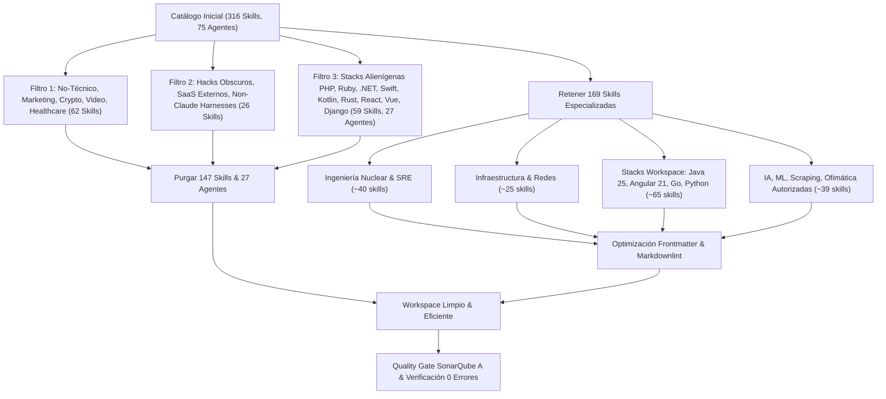

# Plan de Toma de Requisitos y Arquitectura: Barrido Completo y Optimización de Skills

> **Documento de Requisitos y Arquitectura (Template `doc/TEMPLATE_REQUISITOS_ARQUITECTURA.md`)**  
> **Proyecto**: `ecc` (Ecosistema Maestro ECC-AGY / Home-Lab)  
> **Tipo de Intervención**: Refactorización Arquitectónica, Barrido y Optimización de Skills y Agentes  
> **Fecha**: 2026-11-07  
> **Autor**: Antigravity Assistant & Master  

---

## 1. Contexto y Metadatos de la Petición

- **Proyecto / Módulo**: `ecc` (Monorepo ECC-AGY y distribución global)
- **Tipo de Intervención**: Refactorización Arquitectónica / Higiene de Ecosistema
- **Objetivo Principal**: Realizar un barrido integral del catálogo de skills y agentes de ECC, eliminando 147 skills y 27 agentes ajenos al workspace o inútiles (marketing, cripto, healthcare, legal/aduanas, 3D/video, hacks personales y stacks alienígenas como PHP, Ruby, Perl, .NET, Swift, Kotlin, Rust, React, Vue, Django, Quarkus). Conservar y optimizar las 169 skills de ingeniería nuclear, SRE, seguridad, infraestructura (Docker, K8s, Linux, Redes), stacks de proyecto (Java 25/Spring Boot 4, Angular 21/TS/Web, Go/Microservicios, Python/FastAPI), IA/ML (PyTorch, RecSys) y ofimática/scraping autorizados por el usuario.

---

## 2. Toma de Requisitos Detallada y Criterios de Aceptación

### 2.1. Requisitos Funcionales (`RF`)

- **`RF-01`**: Eliminación atómica de 147 skills identificadas como bloat / ajenas de `skills/` y su espejo `ecc-agy/skills/`.
- **`RF-02`**: Eliminación atómica de 27 agentes vinculados a los stacks eliminados de `agents/` y su espejo `ecc-agy/agents/`.
- **`RF-03`**: Optimización integral de las 169 skills retenidas: auditar frontmatter (`name`, `description`), asegurar descripciones unilínea $\le 140$ caracteres con keywords de activación y límites negativos claros, y formateo DavidAnson markdownlint (`MD022`, `MD032`, `MD031`, `MD009`, `MD012`, `MD047`).
- **`RF-04`**: Actualización de scripts de sincronización (`ecc-agy-sync.ps1`, `ecc-agy-sync.sh`) para reflejar el catálogo depurado y verificar despliegue en `~/.gemini/config/plugins/ecc-agy`.
- **`RF-05`**: Verificación continua de tests unitarios (`pytest`), `workspace_audit.py`, `sonar_audit.py`, `security_audit.py` y `lint-markdown.ps1`.

### 2.2. Requisitos No Funcionales (`RNF`)

- **Rendimiento / Eficiencia de Tokens**:
  - Reducción del catálogo total de skills de 316 a 169 skills (ahorro de ~47% en volumen total).
  - Preservación estricta de la arquitectura Two-Tier (ADR-0001): el plugin global de Nivel 1 se mantiene en 21 skills nucleares (~701 tokens).
- **Calidad de Código**:
  - SonarQube Quality Gate Rating A (0 violaciones, Cognitive Complexity $\le 15$, 0 bloques vacíos, $\le 7$ parámetros).
  - 100% de cumplimiento con `.markdownlint.json`.
- **Usabilidad (DX)**:
  - Eliminación de ruido contextual en la invocación de skills y subagentes.
  - Cero ambigüedad en la selección de herramientas para los proyectos del workspace (`kakebo`, `cluster`, `whoiam`, `identity`, `doc-viewer`, `token-hill`, `scripts`).

### 2.3. Criterios de Aceptación (`CA`)

- [x] **`CA-01`**: Las 147 skills identificadas son eliminadas de `skills/` y `ecc-agy/skills/`.
- [x] **`CA-02`**: Los 27 agentes vinculados a stacks alienígenas son eliminados de `agents/` y `ecc-agy/agents/`.
- [x] **`CA-03`**: Las 169 skills retenidas cumplen con el límite $\le 140$ caracteres en `description` y formato YAML válido.
- [x] **`CA-04`**: Todos los tests unitarios (`pytest scripts/ecc-agy/tests/`) pasan con éxito (100%).
- [x] **`CA-05`**: `workspace_audit.py`, `sonar_audit.py`, `security_audit.py` y `lint-markdown.ps1` superan la validación con código de salida `0`.

---

## 3. Auditoría de Reutilización y Retrocompatibilidad

### 3.1. Reutilización de Activos

- **Herramientas existentes**:
  - `scripts/ecc-agy/workspace_audit.py`: Auditoría de tokens, higiene y artefactos muertos.
  - `scripts/ecc-agy/sonar_audit.py`: Verificación de Quality Gate A.
  - `scripts/ecc-agy/security_audit.py`: Escaneo de inyecciones y credenciales.
  - `scripts/bin/ecc-agy/lint-markdown.ps1`: Linter DavidAnson basado en `.markdownlint.json`.
  - `ecc-agy-sync.ps1` y `install.ps1`: Sincronización modular Two-Tier (ADR-0001).

### 3.2. Retrocompatibilidad y Blast Radius

- **Proyectos de Home-Lab Afectados**: Cero impacto negativo. Ningún proyecto activo (`kakebo`, `cluster`, `whoiam`, `identity`, `doc-viewer`, `token-hill`, `scripts`) utiliza PHP, Ruby, Perl, .NET, Swift, Kotlin, Rust, React, Vue, Django, o Quarkus.
- **Rollback Strategy**: Control de versiones en rama Git efímera `feat/ecc/skills-sweep-optimization`. Si se requiriese recuperar alguna skill eliminada, se restaura atómicamente desde el historial de Git (`git checkout origin/main -- skills/<nombre>`).

---

## 4. Arquitectura y Diagrama de Flujo del Barrido

---

## 5. Estimación de Costes

- **Coste Visible**:
  - Tiempo de ejecución: ~1-2 minutos de script automatizado de barrido.
  - Archivos afectados: Eliminación de 147 directorios en `skills/` y `ecc-agy/skills/`, 27 archivos en `agents/` y `ecc-agy/agents/`.
- **Coste Oculto**:
  - Cero deuda técnica agregada.
  - Reducción drástica del ruido cognitivo para desarrolladores y agentes IA al interactuar con el workspace.
  - Prevención de desbordamiento de tokens y fallos silenciosos.
