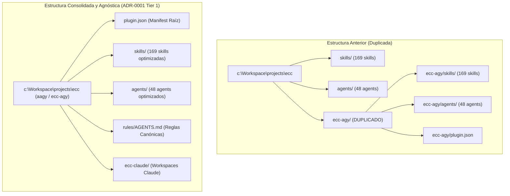

# Plan de Requisitos y Arquitectura: Tarea 1.1 - Desacoplamiento Agnóstico y Saneamiento de Submódulos

> **Documento de Requisitos y Arquitectura (Template `doc/TEMPLATE_REQUISITOS_ARQUITECTURA.md`)**  
> **Proyecto**: `ecc` -> `aagy` (Universal Plugin Harness)  
> **Tipo de Intervención**: Refactorización Arquitectónica y Saneamiento Estructural  
> **Fecha**: 2026-11-07  
> **Autor**: Antigravity Assistant & Master  

---

## 1. Contexto y Metadatos de la Petición

- **Proyecto / Módulo**: `ecc` (Monorepo Master)
- **Tipo de Intervención**: Refactorización Arquitectónica / Saneamiento
- **Objetivo Principal**: Eliminar la redundancia estructural histórica eliminando definitivamente el subdirectorio duplicado `ecc-agy/`, consolidar `plugin.json` en la raíz del repositorio con identidad agnóstica universal `aagy` (Anything, Anywhere, Gemini / Antigravity), y desacoplar las referencias hardcodeadas para garantizar portabilidad agnóstica entre proyectos y entornos.

---

## 2. Toma de Requisitos Detallada y Criterios de Aceptación

### 2.1. Requisitos Funcionales (`RF`)

- **`RF-01`**: Eliminar completamente el directorio redundante `ecc-agy/` (skills, agents, scripts duplicados) manteniendo `ecc-claude` intacto.
- **`RF-02`**: Consolidar `plugin.json` en la raíz de `ecc` definiendo el plugin universal `aagy` / `ecc-agy`.
- **`RF-03`**: Actualizar `package.json` y `ecc.json` para reflejar la eliminación de la distribución anidada `ecc-agy/`.
- **`RF-04`**: Actualizar `ecc-agy-sync.ps1`, `ecc-agy-sync.sh`, `install.ps1` y `scripts/ecc-agy/workspace_audit.py` para resolver exclusivamente los recursos de la raíz (`skills/`, `agents/`, `rules/`), eliminando fallbacks obsoletos a `ecc-agy/`.
- **`RF-05`**: Actualizar y verificar los tests unitarios (`pytest`) asegurando 100% de éxito.

### 2.2. Requisitos No Funcionales (`RNF`)

- **Higiene y Espacio**: Eliminación de cientos de archivos duplicados innecesarios.
- **Rendimiento de Auditoría**: `workspace_audit.py` reduce a la mitad el tiempo de escaneo al no tener que auditar el árbol duplicado de `ecc-agy/`.
- **Calidad de Código**: Cumplimiento del SonarQube Quality Gate Rating A (0 violaciones).
- **Markdownlint**: 100% de cumplimiento con `.markdownlint.json`.

### 2.3. Criterios de Aceptación (`CA`)

- [x] **`CA-01`**: El directorio `ecc-agy/` ha sido eliminado y no quedan referencias rotas a submódulos.
- [x] **`CA-02`**: `plugin.json` reside en la raíz y es válido para Antigravity.
- [x] **`CA-03`**: `workspace_audit.py` audita la raíz con 0 errores de higiene o artefactos muertos.
- [x] **`CA-04`**: Todos los tests unitarios (`pytest`) pasan con código de salida `0`.
- [x] **`CA-05`**: SonarQube audit (`sonar-audit.ps1`) y Security audit (`security-audit.ps1`) finalizan con código `0`.

---

## 3. Diagrama Arquitectónico de Consolidación

---

## 4. Estrategia de Rollback

Si surge alguna incompatibilidad en el despliegue del plugin, se revierte atómicamente la rama Git `feat/ecc/aagy-decoupling-submodules`.
