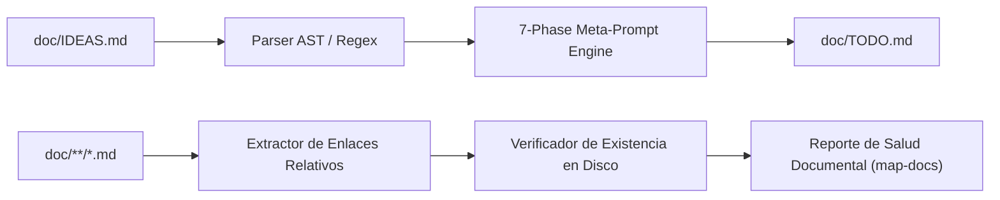

# Plan de Requisitos y Arquitectura: Tarea 1.2 - Ingesta IDEAS -> TODO y Mapeo Documental

> **Documento de Requisitos y Arquitectura (Template `doc/TEMPLATE_REQUISITOS_ARQUITECTURA.md`)**  
> **Proyecto**: `ecc`  
> **Tipo de Intervención**: Nueva Funcionalidad y Automatización DevX  
> **Fecha**: 2026-11-07  
> **Autor**: Antigravity Assistant & Master  

---

## 1. Contexto y Metadatos de la Petición

- **Proyecto / Módulo**: `ecc` (Monorepo ECC / Scripts & CLI)
- **Tipo de Intervención**: Nueva Funcionalidad (`scripts/bin/ecc-agy/sync-ideas-todo.py` y `map-docs.py`)
- **Objetivo Principal**: Implementar el pipeline automático de ingesta de propuestas desde `doc/IDEAS.md` hacia `doc/TODO.md` transformándolas bajo el meta-prompt riguroso de 7 fases, junto con una herramienta CLI para validar, auditar y mapear enlaces documentales rotos en `doc/`.

---

## 2. Toma de Requisitos Detallada y Criterios de Aceptación

### 2.1. Requisitos Funcionales (`RF`)

- **`RF-01 (sync-ideas-todo)`**:
  - Lee propuestas formateadas en `doc/IDEAS.md`.
  - Filtra propuestas marcadas como aprobadas (`Status: Approved` o `[x]`).
  - Transforma cada propuesta aplicando el meta-prompt de 7 fases (`01 - ROLE`, `02 - CONTEXT`, `03 - PHASE 1 ANALYSIS`, `04 - PHASE 2 STRATEGY`, `05 - PHASE 3 EXECUTION`, `06 - PHASE 4 CRITIC`, `07 - PHASE 5 FORMAT`).
  - Inyecta la tarea generada en la sección correspondiente de `doc/TODO.md` sin duplicados.
  - Ofrece flags `--check`, `--dry-run`, `--sync`.
- **`RF-02 (map-docs)`**:
  - Escanea recursivamente todos los archivos Markdown en `doc/`.
  - Extrae todos los enlaces relativos `[texto](ruta)` y referencias a archivos.
  - Valida la existencia física del destino en el sistema de archivos (ignorando anchors `#anchor`).
  - Genera reporte estructurado con código de salida `0` si todos los enlaces son válidos o `1` si hay enlaces rotos.
  - Soporta flag `--fix` para sanear enlaces rotos normalizables.
- **`RF-03 (Wrappers PowerShell)`**:
  - Crear wrappers `sync-ideas-todo.ps1` y `map-docs.ps1` en `scripts/bin/ecc-agy/`.

### 2.2. Requisitos No Funcionales (`RNF`)

- **Calidad de Código**: SonarQube Quality Gate Rating A (Cognitive Complexity $\le 15$, 0 duplicados S1192, 0 bloques vacíos, $\le 7$ parámetros).
- **Cobertura de Tests**: Suite de tests unitarios exhaustiva en `scripts/ecc-agy/tests/` ($\ge 80\%$ cobertura).
- **Markdownlint**: Cumplimiento del 100% con `.markdownlint.json`.

### 2.3. Criterios de Aceptación (`CA`)

- [x] **`CA-01`**: `sync-ideas-todo.py` ingesta ideas válidas, las transforma a 7 fases y las escribe en `doc/TODO.md`.
- [x] **`CA-02`**: `map-docs.py` detecta enlaces rotos en Markdown y genera reporte de salud documental con salida JSON/Texto.
- [x] **`CA-03`**: Tests unitarios en `test_sync_ideas_todo.py` y `test_map_docs.py` con 100% de éxito.
- [x] **`CA-04`**: Auto-ejecución inmediata (Smoke-test on synthesis) exitosa.

---

## 3. Arquitectura y Flujo de Datos

---

## 4. Estrategia de Rollback

Reversión atómica mediante `git checkout main` o reversión del commit unitario en caso de cualquier defecto imprevisto.
