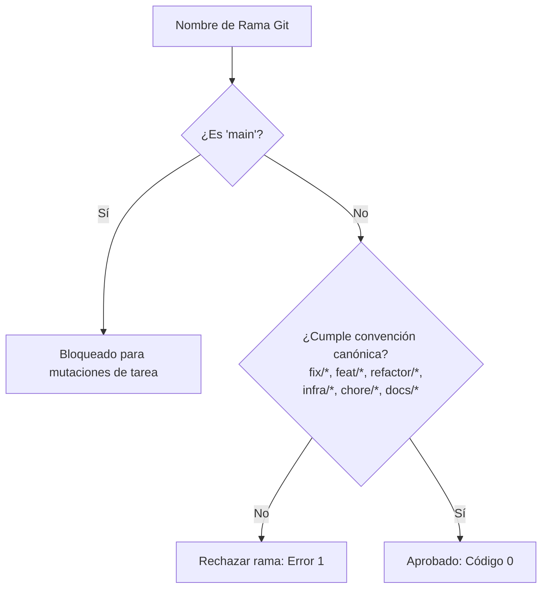

# Plan de Requisitos y Arquitectura: Tarea 1.3 - Estandarización de Política de Ramas de Incidencias en el Harness

> **Documento de Requisitos y Arquitectura (Template `doc/TEMPLATE_REQUISITOS_ARQUITECTURA.md`)**  
> **Proyecto**: `ecc` (Arnés de Gobernanza & GitOps)  
> **Tipo de Intervención**: Gobernanza y Guardrails de Ramas Git  
> **Fecha**: 2026-11-07  
> **Autor**: Antigravity Assistant & Master  

---

## 1. Contexto y Metadatos de la Petición

- **Proyecto / Módulo**: `ecc` (GitOps / Harness Rules & Git Automation)
- **Tipo de Intervención**: Guardrail de Gobernanza y Validación GitOps
- **Objetivo Principal**: Formalizar e implementar la política estricta de ramas en el harness para que cualquier corrección, bugfix o gestión de incidente se origine obligatoriamente bajo el prefijo `fix/<identificador>` (o `fix/<proyecto>/<identificador>`), integrando el validador en `git-flow-helper`, `complete-task-pr` y hooks de Git sin falsos positivos en ramas de características o infraestructura.

---

## 2. Toma de Requisitos Detallada y Criterios de Aceptación

### 2.1. Requisitos Funcionales (`RF`)

- **`RF-01 (Validador de Nombres de Rama)`**:
  - Implementar validador determinista `scripts/ecc-agy/validate_branch.py` con regex canónica:
    - Ramas principales/tronco: `main`.
    - Ramas de incidencias/bugfixes: `^fix/([a-z0-9._-]+/)?([a-z0-9._-]+)$`.
    - Ramas de tareas: `^(feat|refactor|infra|chore|docs|test)/([a-z0-9._-]+/)?([a-z0-9._-]+)$`.
  - Rechazar ramas sin tipo canónico, con mayúsculas, espacios o caracteres prohibidos.
- **`RF-02 (Integración en complete-task-pr & git-flow-helper)`**:
  - `complete-task-pr.ps1` debe validar el nombre de la rama activa antes de ejecutar el aviso y el commit.
  - Rechazar si la rama es `main` directamente o no cumple la convención canónica.
- **`RF-03 (Regla en rules/AGENTS.md)`**:
  - Documentar formalmente la política en las reglas universales del harness.
- **`RF-04 (Tests Unitarios)`**:
  - Suite de tests unitarios exhaustiva en `scripts/ecc-agy/tests/test_validate_branch.py` validando casos válidos e inválidos.

### 2.2. Requisitos No Funcionales (`RNF`)

- **Calidad de Código**: Cumplimiento de SonarQube Quality Gate Rating A (Cognitive Complexity $\le 15$, 0 duplicados S1192).
- **Latencia de Ejecución**: Validación instantánea (<50ms).
- **Markdownlint**: Cumplimiento del 100% con `.markdownlint.json`.

### 2.3. Criterios de Aceptación (`CA`)

- [x] **`CA-01`**: `validate_branch.py` valida correctamente ramas `fix/*`, `feat/*`, etc., y rechaza ramas inválidas con código 1.
- [x] **`CA-02`**: `complete-task-pr.ps1` bloquea ejecución sobre nombres de rama no conformes.
- [x] **`CA-03`**: Suite de tests unitarios pasando al 100%.
- [x] **`CA-04`**: Regla documentada en `rules/AGENTS.md`.

---

## 3. Diagrama de Validación de Ramas

