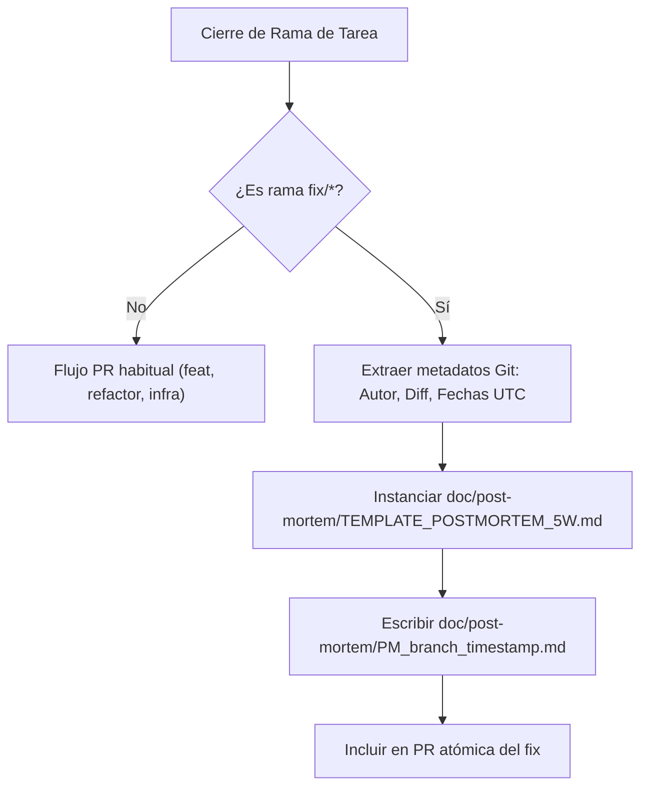

# Plan de Requisitos y Arquitectura: Tarea 1.4 - Generador Automatizado de Post-Mortem 5W

> **Documento de Requisitos y Arquitectura (Template `doc/TEMPLATE_REQUISITOS_ARQUITECTURA.md`)**  
> **Proyecto**: `ecc` (SRE Governance & Incident Lifecycle)  
> **Tipo de Intervención**: Automatización SRE & Plantilla Canónica Post-Mortem 5W  
> **Fecha**: 2026-11-07  
> **Autor**: Antigravity Assistant & Master  

---

## 1. Contexto y Metadatos de la Petición

- **Proyecto / Módulo**: `ecc` (SRE Tooling / Incident Post-Mortem)
- **Tipo de Intervención**: Nueva Funcionalidad e Integración con Ciclo Git
- **Objetivo Principal**: Automatizar la creación obligatoria del documento de autopsia post-incidencia tras el cierre de ramas `fix/*`, siguiendo el patrón de nombrado `PM_<branch>_<timestamp>.md` y estructurado con el análisis exhaustivo de las 5W (Who, What, When, Where, Why/How) y los 5 Porqués (*5-Whys*), integrando su generación en `complete-task-pr.ps1`.

---

## 2. Toma de Requisitos Detallada y Criterios de Aceptación

### 2.1. Requisitos Funcionales (`RF`)

- **`RF-01 (Plantilla Canónica 5W)`**:
  - Crear `doc/post-mortem/TEMPLATE_POSTMORTEM_5W.md` con las secciones canónicas:
    1. Metadatos del Incidente (Rama, Fecha UTC, Severidad SEV-1..SEV-4, SLO afectado).
    2. Resumen Ejecutivo (Blameless).
    3. Análisis de las 5W: Who (servicios/actores), What (anomalía e impacto), When (cronología de detección, diagnóstico y mitigación), Where (entorno LOCAL/SANDBOX/LIVE y rutas), Why/How (Causa raíz y técnica).
    4. Análisis de los 5 Porqués (5-Whys RCA).
    5. Plan de Acción Preventivo y Correctivo (Acciones, Dueño, Prioridad).
- **`RF-02 (Generador Automatizado)`**:
  - Implementar `scripts/ecc-agy/generate_postmortem.py` y wrapper PowerShell `scripts/bin/ecc-agy/generate-postmortem.ps1`.
  - Extraer metadatos de Git: nombre de la rama, autor, timestamp UTC, lista de archivos modificados y diff resumido.
  - Instanciar la plantilla en `doc/post-mortem/PM_<slug_branch>_<timestamp>.md`.
- **`RF-03 (Integración en complete-task-pr)`**:
  - Cuando `complete-task-pr.ps1` detecte que la rama procesada inicia con `fix/`, invocar automáticamente el generador de post-mortem para garantizar que cada fix quede formalmente registrado.
- **`RF-04 (Tests Unitarios)`**:
  - Crear `scripts/ecc-agy/tests/test_generate_postmortem.py` validando la extracción de metadatos, formato de salida y sanitización de nombres.

### 2.2. Requisitos No Funcionales (`RNF`)

- **Calidad de Código**: Cumplimiento de SonarQube Quality Gate Rating A (Cognitive Complexity $\le 15$, 0 duplicados S1192).
- **Markdownlint**: Cumplimiento del 100% con `.markdownlint.json`.
- **Cultura Blameless**: Plantillas neutrales, orientadas al proceso y sistemas, sin atribución individual de culpa.

### 2.3. Criterios de Aceptación (`CA`)

- [x] **`CA-01`**: `TEMPLATE_POSTMORTEM_5W.md` creada y formateada con DavidAnson markdownlint.
- [x] **`CA-02`**: `generate_postmortem.py` genera archivos `PM_<slug>_<timestamp>.md` con metadatos reales de Git.
- [x] **`CA-03`**: Integración en `complete-task-pr.ps1` operativa para ramas `fix/*`.
- [x] **`CA-04`**: Suite de tests unitarios pasando al 100%.

---

## 3. Diagrama de Flujo del Generador Post-Mortem

