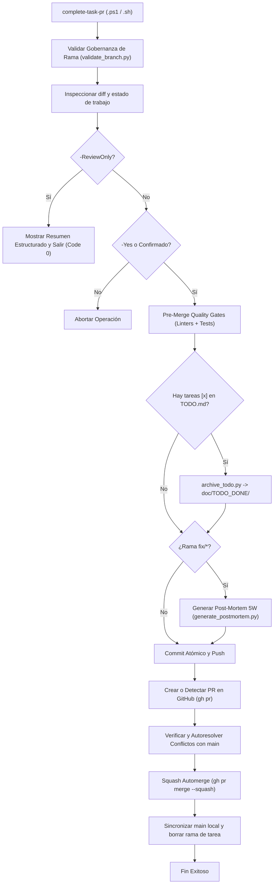

# Plan de Requisitos y Arquitectura: Consolidación y Auditoría de `complete-task-pr`

> **Referencia de Gobernanza**: Tarea 1.5 de `doc/TODO.md`  
> **Fecha**: 2026-11-07  
> **Estado**: En Ejecución  

---

## 1. Contexto y Metadatos de la Petición

- **Proyecto / Módulo**: `ecc-agy` / `scripts/bin/ecc-agy/`
- **Tipo de Intervención**: Refactorización Arquitectónica y Fortalecimiento del Harness
- **Objetivo Principal**: Consolidar y auditar el ciclo integral de finalización de tarea (`complete-task-pr.ps1` y `complete-task-pr.sh`): validación de tests sin regresiones, aviso de revisión previa (Pre-Flight Review), archivado automático de ítems `- [x]` en `doc/TODO.md`, commit atómico estandarizado, apertura de PR y squash automerge con limpieza de ramas.

---

## 2. Toma de Requisitos Detallada y Criterios de Aceptación

### 2.1. Requisitos Funcionales (`RF`)

- **`RF-01`**: Validación exhaustiva previa al commit: ejecutar markdownlint, suite de pruebas unitarias (`pytest`) y auditoría de SonarQube / seguridad antes de cualquier mutación en el repositorio.
- **`RF-02`**: Detección y archivado sincronizado de TODO: Si `doc/TODO.md` contiene ítems completados (`- [x]`), invocar automáticamente `archive_todo.py` / `archive-todo.ps1` para generar el artefacto en `doc/TODO_DONE/` y limpiar `TODO.md` dentro del mismo commit de la tarea.
- **`RF-03`**: Paridad multiplataforma completa entre `complete-task-pr.ps1` y `complete-task-pr.sh`:
  - Validación de gobernanza de ramas con `validate_branch.py`.
  - Generación obligatoria de Post-Mortem 5W (`generate_postmortem.py`) para ramas `fix/*`.
  - Soporte de flags `--review-only`, `--yes`, `--title`, `--body`, `--target`.
- **`RF-04`**: Garantía de confirmación manual estricta: nunca ejecutar mutaciones en modo `-ReviewOnly`, y exigir confirmación interactiva `(s/N)` salvo paso explícito de `-Yes` / `--yes`.
- **`RF-05`**: Integración con `git-flow-helper.ps1` (`-Action complete-task`).

### 2.2. Requisitos No Funcionales (`RNF`)

- **Determinismo y Resiliencia**: Si ocurre cualquier fallo durante el ciclo (pruebas fallidas, linter fallido, conflicto inmanejable), abortar con mensaje descriptivo y dejar el árbol de trabajo intacto sin mutaciones a medio aplicar.
- **Trazabilidad y Visibilidad**: Mostrar claramente el diff, autor, ramas origen y destino, título estructurado y cuerpo antes de la confirmación.

### 2.3. Criterios de Aceptación (`CA`)

- [x] **`CA-01`**: Modo `-ReviewOnly` muestra el aviso estructurado de revisión sin realizar `git add`, `git commit`, `git push` ni crear PRs.
- [x] **`CA-02`**: Tareas marcadas `- [x]` en `doc/TODO.md` son detectadas y archivadas a `doc/TODO_DONE/` antes del commit atómico.
- [x] **`CA-03`**: Ambas implementaciones (PowerShell y Bash) ejecutan el validador de ramas `validate_branch.py` y rechazan ramas no autorizadas o protegidas.
- [x] **`CA-04`**: Ambas implementaciones generan el Post-Mortem 5W cuando la rama coincide con `fix/*`.
- [x] **`CA-05`**: Suite de pruebas unitarias cubre el generador y scripts auxiliares al 100% (código de salida 0).
- [x] **`CA-06`**: SonarQube Rating A (0 violaciones) y markdownlint 100% compliant.

---

## 3. Auditoría de Reutilización y Retrocompatibilidad

### 3.1. Inventario de Activos Existentes a Reutilizar

- `scripts/ecc-agy/validate_branch.py`: Validador canónico de gobernanza de ramas.
- `scripts/ecc-agy/generate_postmortem.py`: Generador de autopsias SRE 5W.
- `scripts/ecc-agy/archive_todo.py`: Motor de archivado de tareas completadas.
- `scripts/bin/ecc-agy/lint-markdown.ps1` / `lint-markdown.sh`: Linter DavidAnson canónico.
- `scripts/bin/ecc-agy/sonar-audit.ps1` / `security-audit.ps1`: Quality gates de código y seguridad.

### 3.2. Impacto en Contratos y Retrocompatibilidad

- **Contratos Afectados**: Cero cambios de ruptura. Las firmas de `complete-task-pr.ps1` y `complete-task-pr.sh` preservan todos sus parámetros existentes (`-Title`, `-Body`, `-TargetBranch`, `-ReviewOnly`, `-Yes`).
- **Retrocompatibilidad**: Completamente retrocompatible con llamadas desde CI o scripts delegados como `git-flow-helper.ps1`.

---

## 4. Arquitectura y Flujo de Ejecución

---

## 5. Análisis de Seguridad y Bastionado

- **Inyección de Comandos**: Argumentos de ramas y commits tratados como cadenas de literales; invocaciones externas mediante APIs seguras de PowerShell/Bash.
- **Principio de Mínimo Privilegio**: Requiere confirmación manual por defecto; banderas de automatización (`-Yes`) son explícitas.
- **Rollback Seguro**: En caso de fallo en cualquier paso previo a la fusión, no se altera `main` ni se envían commits defectuosos a remoto.
