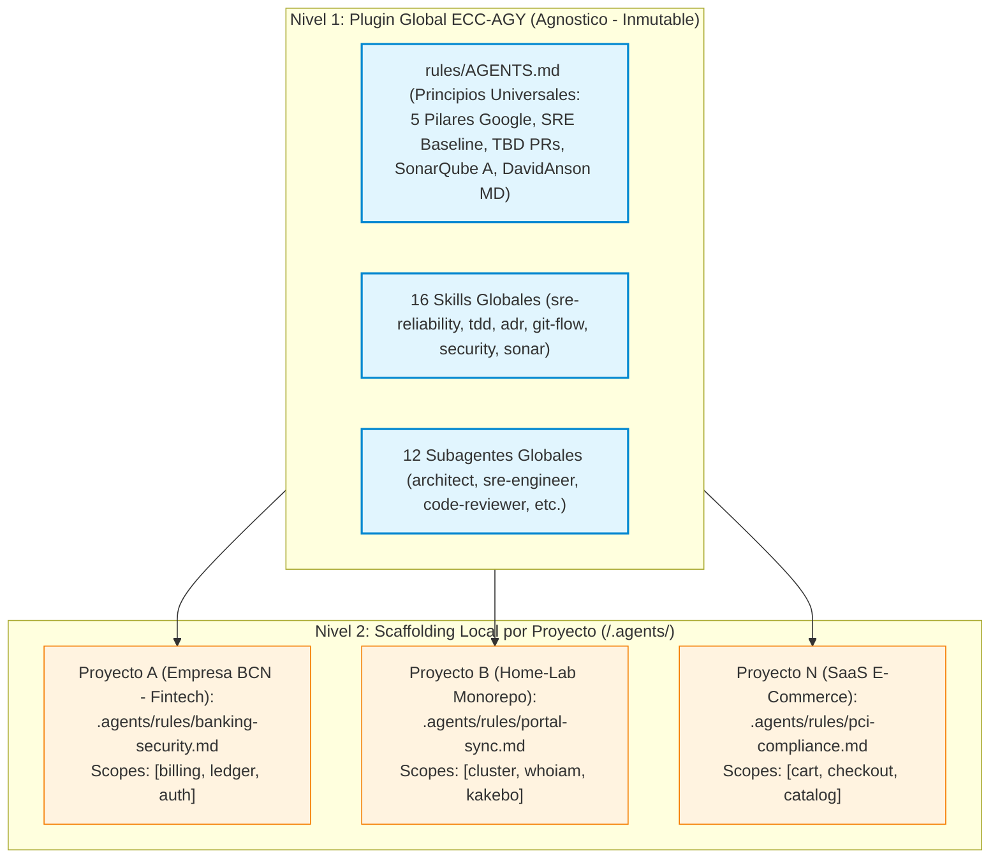

# Informe de Abstracción y Desacoplamiento: Reutilización de `ecc-agy` para $N$ Proyectos

> **Documento de Arquitectura y Estrategia de Reusabilidad**: Especificación técnica para desacoplar el motor de agentes Antigravity de cualquier entorno particular y convertirlo en un acelerador empresarial genérico, exportable e instalable en $N$ proyectos o empresas (ej. corporativos en Barcelona).  
> **Fecha**: 2026-10-26 | **Autor**: Antigravity (ECC-AGY) | **Estado**: Especificación Aprobada

---

## 1. Motivación y Objetivo

El conjunto de reglas, subagentes, skills y automatizaciones desarrolladas en el marco del Home-Lab ha alcanzado un grado de madurez y rigor de nivel industrial (SRE Baseline, SonarQube Rating A, Trunk-Based PRs, 7-phase meta-prompts).

Sin embargo, para poder **utilizar este sistema en cualquier empresa externa, cliente o nuevo proyecto independiente**, es imprescindible desacoplar todas las dependencias específicas del Home-Lab (nombres de servicios, servidores locales, dominios DNS domésticos y reglas de portal), garantizando que:
1. No exista **fuga de datos personales ni infraestructura privada**.
2. Las reglas globales sean **100% agnósticas** al dominio de negocio.
3. El sistema se pueda instanciar en segundos en un nuevo proyecto mediante un **modelo de extensibilidad en 2 niveles**.

---

## 2. Matriz de Acoplamientos Previos vs. Solución Agnóstica

| Área / Componente | Acoplamiento Previo (Home-Lab) | Solución Agnóstica (`ecc-agy` para $N$ Proyectos) |
| ----------------- | ------------------------------ | ------------------------------------------------- |
| **Scopes de Commits** | `[cluster]`, `[kakebo]`, `[whoiam]`, `[net]` hardcodeados en validadores y reglas. | Formato parametrizado `[type]+[scope]: <title>`, donde `[scope]` se autodescubre o se configura en `.agents/config.json`. |
| **Rutas del Monorepo** | Rutas fijas `C:\Workspace\projects\home-lab\` en scripts Python y PowerShell. | Detección dinámica de la raíz del proyecto (`git rev-parse --show-toplevel` o variable `WORKSPACE_ROOT`). |
| **Reglas de Portal Web** | Invariante de sincronización de `/portal` en `cmd/server/main.go`. | Trasladado exclusivamente al nivel de proyecto (`home-lab/.agents/rules/portal.md`). El core agnóstico desconoce `/portal`. |
| **Topología y Servidores** | Referencias explícitas a servidores `FRACTAL`, `NEO` y dominios `*.asuscomm.com`. | Eliminación total. Los entornos se parametrizan como `LOCAL`, `STAGING`/`SANDBOX` y `PRODUCTION`/`LIVE`. |
| **Gobernanza Documental** | Dependencia de roles fijos en `.governance/docs-map.json` del laboratorio. | Estructura adaptable basada en la especificación genérica de `docs-governance` (Spine: AGENTS, INDEX, STATUS, LOG, adr/). |

---

## 3. Arquitectura de Personalización en 2 Niveles (*Two-Tier Customization*)

Para que un único plugin global atienda a $N$ proyectos heterogéneos sin colisiones de reglas ni sobrecarga de tokens, se adopta el patrón de **Personalización en 2 Niveles**:



### Nivel 1: Core Global (`ecc-agy`)
- Instalado una sola vez en el sistema (`~/.gemini/config/plugins/ecc-agy/`).
- Aplica a todas las sesiones de Antigravity.
- Define únicamente estándares universales de excelencia técnica:
  - Google 5-Pillar Alignment.
  - SRE Baseline (ADR-0008: Error Budgets, 4 Golden Signals, Blast Radius, Toil <50%).
  - TDD estricto y cobertura $\ge 80\%$.
  - Clean Code y SonarQube Rating A.
  - DavidAnson markdownlint.

### Nivel 2: Scaffolding Local (`<project>/.agents/`)
- Reside en el directorio de cada proyecto individual.
- Sobrescribe o extiende el comportamiento sin modificar el plugin global:
  - `<project>/.agents/rules/`: Reglas de negocio particulares, restricciones legales o tecnologías concretas.
  - `<project>/.agents/skills/`: Skills bajo demanda exclusivas del proyecto.
  - `<project>/.agents/agents/`: Subagentes especializados en el stack local.
  - `<project>/.agents/config.json`: Lista de scopes válidos para commits y variables de entorno.

---

## 4. Matriz de Reutilización: Qué Viaja y Qué se Aísla

```
┌────────────────────────────────────────────────────────────────────────┐
│                        ECOSISTEMA REUTILIZABLE                         │
├───────────────────────────────────┬────────────────────────────────────┤
│ VIAJA EN `ecc-agy` (Agnóstico)    │ PERMANECE EN `ecc-agy-homelab`     │
├───────────────────────────────────┼────────────────────────────────────┤
│ • 16 Skills Globales              │ • Sincronización de /portal        │
│ • 12 Subagentes de Contexto       │ • Scopes: cluster, whoiam, kakebo  │
│ • SRE Baseline (ADR-0008)         │ • Topología FRACTAL / NEO          │
│ • Trunk-Based PRs (ADR-0006)      │ • Configuración Split-DNS local    │
│ • Quality Gate SonarQube (A)      │ • WireGuard / OpenVPN doméstico    │
│ • DavidAnson markdownlint         │ • Dependencias multi-cloud locales │
│ • 7-Phase Meta-Prompt Engine      │ • Dominios *.asuscomm.com          │
│ • Toil Automation Engine          │ • Certificados TLS personales      │
└───────────────────────────────────┴────────────────────────────────────┘
```

---

## 5. Guía de Despliegue en un Nuevo Proyecto ($N$ Proyectos)

Para iniciar cualquier nuevo proyecto (ej. en una empresa en Barcelona):

### Paso 1: Instalar el Plugin Agnóstico
```powershell
pwsh -File C:\Workspace\projects\ecc-aecb\install.ps1 -Target agy
```

### Paso 2: Inicializar el Scaffolding del Proyecto
Dentro de la raíz del nuevo repositorio:
```powershell
New-Item -ItemType Directory -Path ".agents\rules" -Force
```

### Paso 3: Configurar los Scopes del Proyecto (`.agents/config.json`)
```json
{
  "projectName": "empresa-bcn-core",
  "allowedScopes": ["api", "auth", "frontend", "infra", "docs"],
  "sre": {
    "targetUptime": "99.9%",
    "maxLatencyP95Ms": 200
  }
}
```

### Paso 4: Añadir Reglas de Negocio Locales (`.agents/rules/business.md`)
Cualquier restricción específica (ej. cumplimiento de RGPD, esquema bancario, estilo UI corporativo) se ubica en este archivo. Antigravity lo detecta e ingesta automáticamente con prioridad sobre el contexto.

---

## 6. Viabilidad Comercial y Regulatoria (Barcelona / UE)

1. **Licencia de Código Abierto Permisiva**: Distribuido bajo licencia **MIT**, permitiendo su uso comercial irrestricto en empresas privadas sin pago de cánones ni licencias comerciales.
2. **Cumplimiento RGPD / LOPDGDD**: Al haberse purgado toda IP y DNS personal, el framework agnóstico no almacena ni procesa datos de carácter personal.
3. **Ergonomía de Equipo**: Los desarrolladores de la empresa obtienen calidad garantizada sin fricción: los Quality Gates automatizados actúan antes de abrir Pull Requests, reduciendo drásticamente el tiempo de code review y los fallos en producción.
