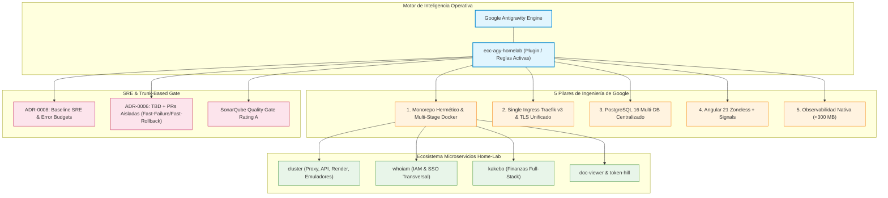

# Informe de Funcionamiento y Operativa: Fork Especializado `ecc-agy-homelab`

> **Documento de Arquitectura y Operaciones**: Análisis en profundidad del funcionamiento, ciclo de vida, agentes, skills y automatizaciones del fork [`ecc-agy-homelab`](https://github.com/ACB75/ecc-agy-homelab).  
> **Fecha**: 2026-10-26 | **Autor**: Antigravity (ECC-AGY) | **Estado**: Vigente en Producción

---

## 1. Misión y Alcance del Fork

`ecc-agy-homelab` es la especialización de Everything Claude Code (ECC) para el motor **Google Antigravity (AGY)** configurada específicamente para gobernar el monorepo y la infraestructura física del **Home-Lab**.

A diferencia de una distribución genérica, este fork actúa como el **cerebro operacional** que conoce la topología del clúster, las convenciones de nomenclatura, las dependencias entre microservicios y las políticas de despliegue en los servidores físicos (`FRACTAL` y `NEO`).



---

## 2. Invariantes y Reglas Operativas Nucleares

El comportamiento de los agentes en este fork se rige por las siguientes reglas estrictas documentadas en su `AGENTS.md`:

### 2.1. Formato Obligatorio de Commits y Mensajes Explicativos

- **Sintaxis**: `[type]+[projects]: <title>`
  - Tipos válidos: `feat`, `fix`, `refactor`, `chore`, `docs`, `test`, `perf`, `build`, `ci`, `sec`.
  - Proyectos autorizados: `[cluster]`, `[kakebo]`, `[whoiam]`, `[net]`, `[scripts]`, `[ecc-agy]`, `[doc]`, o combinaciones (`[cluster,doc]`).
- **Cuerpo Explicativo Obligatorio (`msg comment`)**: Todo commit debe incluir un cuerpo explicativo multilínea detallando la motivación, cambios técnicos, arquitectura y tests ejecutados (código de salida 0). Prohibidos los commits de una sola línea.
- **Prohibición de Commits Autónomos**: Los agentes solo redactan la propuesta; la ejecución final de `git commit` y `git push` corresponde siempre al usuario tras confirmación explícita.

### 2.2. Trunk-Based Development con PRs Aisladas (ADR-0006)

- Tronco principal `main` siempre verde, desplegable y hermético.
- Cada cambio o tarea nace en una rama efímera (`<type>/<project>/<name>`) y se integra mediante **Pull Request (PR)** aislada.
- **Fast-Failure**: Las pruebas de integración, análisis de cobertura ($\ge 80\%$) y linters se ejecutan en la PR. Si algo falla, el tronco no se contamina.
- **Fast-Rollback**: Fusión atómica mediante *Squash and Merge*. Cada tarea es exactamente un commit en `main`, permitiendo reversión instantánea sin efecto dominó.

### 2.3. Baseline SRE y Resiliencia Operativa (ADR-0008)

- **4 Señales Doradas**: Latencia (p95 < 200ms, p99 < 1s), Tráfico RPS, Tasa de Errores 5xx (<0.1%) y Saturación de recursos (<85% RAM, <80% DB Pool).
- **Gobernanza de Error Budget**: Si el presupuesto mensual de error se agota, se congelan despliegues de nuevas características y el 100% del esfuerzo técnico pasa a fiabilidad.
- **Defensas en Límites**: Timeouts obligatorios (2s-5s), Circuit Breakers, Bulkheads y Jittered Exponential Backoff.
- **Toil < 50%**: Toda operación repetida $\ge 2$ veces se automatiza en `scripts/bin/<project>/`.
- **Throttling de Memoria**: Límite explícito en todos los contenedores y `GOMEMLIMIT=80%` en Go para evitar OOM kills repentinos del kernel.

### 2.4. Sincronización Obligatoria de `/portal`

- Toda alteración en puertos, contenedores o rutas Traefik (`cluster/docker-compose.yml`, `dynamic.yml`, CoreDNS) obliga a actualizar el catálogo maestro en `cluster/renderer/catalog/services.yaml` y verificar consistencia mediante `pwsh -File scripts/bin/cluster/sync-portal.ps1 -Audit`.

---

## 3. Catálogo de Agentes y Skills del Fork

El fork mantiene 12 subagentes especializados y 16 skills ajustadas con presupuesto de tokens acotado ($\le 120$ caracteres en agentes, $\le 140$ caracteres en skills):

### Subagentes de Contexto Aislado (`agents/`)

| Subagente | Modelo | Herramientas | Rol Operativo en Home-Lab |
| --------- | ------ | ------------ | ------------------------- |
| `sre-engineer` | `flash` | Read, Grep, Glob | Auditor de fiabilidad SRE, límites de memoria, probes y postmortems. |
| `architect` | `inherit` | Read, Grep, Glob | Diseño de sistemas, evaluación de costes y redacción de ADRs. |
| `code-reviewer` | `inherit` | Read, Grep, Glob | Auditor de SonarQube (S3776, S1192, S107, S112) y principios SOLID. |
| `security-reviewer` | `inherit` | Read, Grep, Glob | Auditor de seguridad (secretos, inyección SQL, XSS, CSRF, SSRF, AuthN/AuthZ). |
| `silent-failure-hunter` | `flash` | Read, Grep, Glob | Caza de bloques catch vacíos, errores tragados y fallbacks inseguros. |
| `tdd-guide` | `inherit` | Read, Grep, Glob | Guía TDD (RED -> GREEN -> REFACTOR) y cobertura $\ge 80\%$. |
| `todo-archiver` | `flash` | Read, Grep, Glob | Archivo sistemático de tareas completadas hacia `/TODO_DONE/`. |
| `sync-aligner` | `flash` | Read, Grep, Glob | Mantenimiento de alineación y sincronización sin deriva. |

### Skills Especializadas (`skills/`)

- `sre-reliability`: Métricas doradas, umbrales, fórmulas de error budget y checklist de resiliencia.
- `sonarqube-quality-gate`: Reglas estáticas S3776 (complejidad $\le 15$), S1192 (duplicados), S107, S112 y S1452.
- `git-workflow` & `conventional-commit-review`: Flujo Trunk-Based, apertura de PRs y validación de títulos.
- `todo-lifecycle`: Transformación mediante meta-prompt riguroso de 7 fases y archivado con timestamp.
- `docs-governance`: Gobernanza del hub documental bajo `.governance/docs-map.json`.

---

## 4. Herramientas y Scripts de Automatización

El fork delega su ejecución en scripts idempotentes ubicados en `scripts/bin/ecc-agy/`:

```
scripts/bin/ecc-agy/
├── audit-workspace.ps1 / .sh    # Auditoría integral en 6 fases (Higiene, Tokens, Redundancia, Reglas, Docs, Sonar)
├── audit-sre.ps1 / .sh          # Auditoría estática SRE (límites de memoria, GOMEMLIMIT, healthchecks, timeouts)
├── git-flow-helper.ps1 / .sh    # Gestión de ramas efímeras, promoción tri-tier y apertura automática de PRs
├── lint-markdown.ps1 / .sh      # Formateador DavidAnson markdownlint (.markdownlint.json)
├── archive-todo.ps1 / .sh       # Archivador automático de tareas completadas a /TODO_DONE/
└── install-git-hooks.ps1 / .sh  # Instalador de githooks locales (commit-msg y protección de ramas)
```

---

## 5. Conclusión y Estado Operativo

`ecc-agy-homelab` es una solución madura, altamente optimizada y estrictamente adaptada a la infraestructura del Home-Lab. Garantiza cero deriva arquitectónica, cumplimiento continuo del Quality Gate y fiabilidad operativa contrastada bajo pruebas automatizadas.
