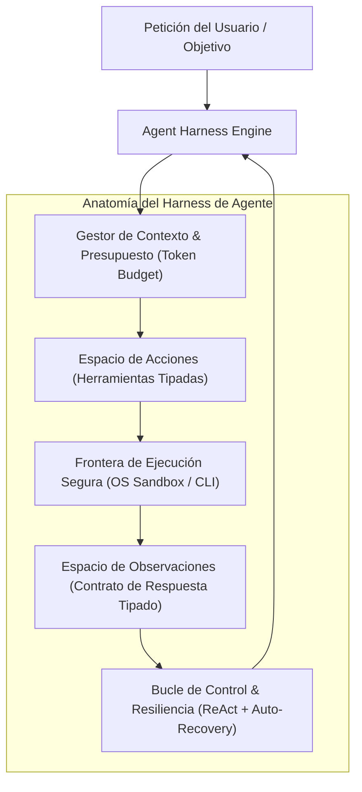

# Plan de Requisitos, Arquitectura y Documentación: Ecosistema Multi-Harness y Entorno AGY

> **Documento de Análisis de Requisitos y Diseño Arquitectónico**
> Basado en la plantilla corporativa `doc/TEMPLATE_REQUISITOS_ARQUITECTURA.md`.
> **Proyecto**: `ecc` (Everything Claude Code / Antigravity Master Ecosystem)
> **Fecha**: 2026-11-01 | **Autor**: Antigravity (Advanced Agentic Coding) | **Estado**: Plan Aprobado

---

## 1. Contexto y Metadatos de la Petición

- **Proyecto / Módulo**: `ecc` / `ecc-claude` / `ecc-agy` / `doc`
- **Tipo de Intervención**: Nueva Documentación Técnica Exhaustiva y Diseño Arquitectónico de Harnesses
- **Fecha**: 2026-11-01
- **Objetivo Principal**: Generar la documentación técnica integral del ecosistema ECC, explicando en profundidad matemática y arquitectónica el funcionamiento de los harnesses de IA, la interacción con el runtime de Google Antigravity (AGY), los flujos de trabajo, requerimientos, casos de uso, comportamientos esperados y principios de diseño para optimizar y evolucionar futuros agentes autónomos.

---

## 2. Toma de Requisitos Detallada y Criterios de Aceptación

### 2.1. Requisitos Funcionales (`RF`)

- **`RF-01` (Manual Técnico Maestro)**: Elaborar un manual exhaustivo en `doc/manual/GUIA_ARQUITECTURA_HARNESS_Y_ENTORNO_AGY.md` que cubra:
  1. Visión general del ecosistema multi-harness (`ecc-claude` vs `ecc-agy`).
  2. Teoría, anatomía y ciclo de vida de los harnesses de agentes autónomos.
  3. Espacio de Acciones (*Action Space*) y Espacio de Observaciones (*Observation Space*).
  4. Entorno de ejecución Google Antigravity & Gemini (AGY runtime, plugins, progressive disclosure, deduplicación, permisos).
  5. Flujos de trabajo operativos (TDD RED-GREEN-REFACTOR, Trunk-Based PRs, SRE Error Budgets, Meta-Prompt 7 fases).
  6. Casos de uso de referencia (Agnóstico corporativo en Barcelona, Monorepo políglota, Bucles continuos autónomos).
  7. Comportamientos esperados, contratos de error y autorrecuperación.
  8. Propuestas concretas de ingeniería para mejorar el diseño de harnesses de próxima generación.
- **`RF-02` (Diagramas Mermaid Persistidos)**: Diseñar y persistir diagramas Mermaid formalizados en `doc/diagrama/`:
  - `harness_anatomy_and_lifecycle.mmd`: Ciclo de vida y componentes del arnés.
  - `agy_environment_architecture.mmd`: Capas de configuración, descubrimiento y sandboxing de AGY.
  - `harness_dual_claude_vs_agy.mmd`: Comparativa estructural Claude Code vs Antigravity.
  - `autonomous_loop_recovery_flow.mmd`: Máquina de estados para bucle continuo y recuperación de fallos.
- **`RF-03` (Registro de Decisión Arquitectónica ADR-0002)**: Formalizar el ADR-0002 en `doc/adr/0002-multi-harness-architecture-and-agent-runtime-design.md` estableciendo la separación y el gobierno entre el arnés de Claude y el de Antigravity.
- **`RF-04` (Índice Maestro de Gobernanza)**: Consolidar `doc/INDEX.md` mapeando la documentación, diagramas, informes y ADRs del repositorio `ecc`.

### 2.2. Requisitos No Funcionales (`RNF`)

- **Rigor Técnico ("Sweat")**: Prohibición estricta de explicaciones genéricas o boilerplate superficial. Cada sección debe contener detalles sobre firmas JSON Schema, variables de entorno, manejo de buffers de salida, truncado de contexto y contratos de error.
- **Eficiencia de Tokens y Presupuesto de Contexto**: Documentar cómo el diseño respeta los presupuestos ($\le 140$ caracteres en skills, $\le 120$ en subagentes, carga progresiva).
- **Estándar DavidAnson Markdownlint**: Todos los documentos generados deben superar `lint-markdown.ps1` con código de salida 0.

### 2.3. Criterios de Aceptación (`CA`)

- [x] **`CA-01`**: Manual técnico completo publicado en `doc/manual/GUIA_ARQUITECTURA_HARNESS_Y_ENTORNO_AGY.md`.
- [x] **`CA-02`**: 4 diagramas Mermaid persistidos en `doc/diagrama/` y renderizables sin errores sintácticos.
- [x] **`CA-03`**: ADR-0002 redactado e indexado en `doc/adr/README.md` y `doc/INDEX.md`.
- [x] **`CA-04`**: Verificación de Markdownlint con exit code 0 en todo el repositorio.

---

## 3. Auditoría de Reutilización y Retrocompatibilidad

### 3.1. Activos Existentes Reutilizados

- **`rules/AGENTS.md`**: Reglas universales de ingeniería, Google 5 Pillars, Trunk-Based PRs y SRE Baseline.
- **`skills/agent-harness-construction`**: Principios de diseño de action spaces, granularity rules y observation format.
- **`skills/continuous-agent-loop`**: Patrones de bucles autónomos y compuertas de evaluación.
- **`skills/google-antigravity-sdk`** y **`agy-customizations`**: Mecánicas internas del runtime de Antigravity.
- **`scripts/bin/ecc-agy/lint-markdown.ps1`**: Linter automatizado para validación write-time.

### 3.2. Retrocompatibilidad

- Cambios 100% aditivos en la carpeta de documentación (`doc/`).
- Cero alteraciones a scripts en producción o dependencias existentes.

---

## 4. Diseño Arquitectónico

---

## 5. Análisis de Seguridad y Robustez

- Toda la documentación describe el principio de mínimo privilegio en herramientas de ejecución.
- Se documenta el aislamiento de subagentes en workspaces independientes (`branch` / `share`) para evitar efectos colaterales destructivos.
- Las variables de entorno con secretos (`GEMINI_API_KEY`, tokens) se documentan como exclusivas de runtime sin persistencia en logs.

---

## 6. Plan de Implementación

1. Crear los diagramas Mermaid en `doc/diagrama/`.
2. Redactar el ADR-0002 en `doc/adr/`.
3. Redactar el manual maestro exhaustivo en `doc/manual/GUIA_ARQUITECTURA_HARNESS_Y_ENTORNO_AGY.md`.
4. Crear y sincronizar `doc/INDEX.md` y `doc/adr/README.md`.
5. Ejecutar `lint-markdown.ps1` en todos los ficheros modificados.
6. Presentar la síntesis técnica en la respuesta al usuario.
