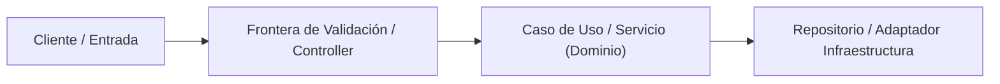

# Plantilla de Toma de Requisitos, Diseño de Arquitectura, Seguridad y Análisis de Costes

> **Instrucciones de Uso (Regla Global ECC-AGY)**:
> Por cada petición de **nueva funcionalidad** o **corrección (bugfix/refactor)**, el agente debe generar y adaptar esta toma de requisitos y plan arquitectónico antes de escribir código de producción.

---

## 1. Contexto y Metadatos de la Petición
- **Proyecto / Módulo**: `<cluster | kakebo-backend | kakebo-frontend | net | ecc-agy | scripts | token-hill>`
- **Tipo de Intervención**: `<Nueva Funcionalidad | Corrección de Bug | Refactorización Arquitectónica | Bastionado de Seguridad>`
- **Fecha**: `YYYY-MM-DD`
- **Objetivo Principal**: Resumen conciso (1-3 líneas) del problema a resolver o valor a entregar.

---

## 2. Toma de Requisitos Detallada y Criterios de Aceptación

### 2.1. Requisitos Funcionales (`RF`)
- **`RF-01`**: Descripción exacta del comportamiento esperado, entradas, transformaciones y salidas.
- **`RF-02`**: Flujos alternativos y validaciones de negocio requeridas.

### 2.2. Requisitos No Funcionales (`RNF`)
- **Rendimiento / Latencia**: Tiempo de respuesta objetivo, uso de memoria/CPU, paginación o streaming.
- **Concurrencia y Escalabilidad**: Comportamiento bajo carga, inmutabilidad de estado, *statelessness*.
- **Usabilidad (UX / DX)**: Accesibilidad, claridad de feedback de error, ergonomía de la API o interfaz.

### 2.3. Casos Límite (*Edge Cases*) y Condiciones de Fallo
- Entradas nulas, vacías, fuera de rango o malformadas.
- Fallos de red, caídas de base de datos/caché/broker o condiciones de carrera (*race conditions*).

### 2.4. Criterios de Aceptación (`CA` - Verificables por Tests)
- [ ] **`CA-01`**: Dado `<contexto>`, cuando `<acción>`, entonces `<resultado observable>`.
- [ ] **`CA-02`**: Cobertura de tests unitarios/integración $\ge 80\%$ incluyendo casos límite y errores.

---

## 3. Auditoría de Reutilización y Retrocompatibilidad (Prioridad Máxima)

### 3.1. Inventario de Activos Existentes a Reutilizar
> *Prohibido duplicar lógica existente (DRY). Listar servicios, componentes, utilidades, DTOs, esquemas o configuraciones del workspace que se van a reutilizar o extender.*
- **Módulos / Servicios reutilizados**: `[NombreArchivo](file:///ruta/absoluta)` -> Qué pieza se reutiliza y cómo.
- **Dependencias**: Confirmación de uso exclusivo de APIs nativas del lenguaje/framework y paquetes oficiales ya instalados *(Cero dependencias de terceros no oficiales sin advertencia y confirmación explícita previa del usuario)*.

### 3.2. Impacto en Contratos y Estrategia de Retrocompatibilidad
- **Contratos Afectados** (REST API, Esquema SQL/JSONB, Eventos Kafka/Ignite, Inputs/Outputs UI, Variables `.env`):
  - `Ninguno` o detalle del cambio aditivo (no destructivo).
- **Garantía de Retrocompatibilidad (*Backward Compatibility*)**:
  - Cómo se asegura que los consumidores actuales, tests existentes y datos persistidos sigan funcionando sin roturas (*Zero-Breaking Changes*).
- **Plan de Rollback**: Pasos inmediatos para revertir el cambio de forma segura si se detecta una anomalía.

---

## 4. Arquitectura, Patrones de Diseño, Clean Code y Refactorización

### 4.1. Diseño Arquitectónico y Flujo de Datos

### 4.2. Patrones de Diseño y Arquitectura Aplicados
- **Patrones Arquitectónicos**: *(Ej. Capas Limpias, Hexagonal/Puertos y Adaptadores, CQRS ligero, Event-Driven, Standalone Signals OnPush)*.
- **Patrones de Diseño (GoF / Estructurales / Comportamiento)**: *(Ej. Strategy, Factory, Adapter, Decorator, Builder inmutable, Repository)* y justificación de por qué resuelven el problema sin sobreingeniería (YAGNI).

### 4.3. Aplicación de Clean Code
- **Inmutabilidad**: Uso de `record` / `final` (Java), `readonly` / `signal` (TS/Angular), `@dataclass(frozen=True)` / Pydantic v2 (Python).
- **Simplicidad y Legibilidad**: Funciones pequeñas con responsabilidad única (SRP), *early returns* ($<4$ niveles de anidamiento), nombres expresivos de dominio y tipado estricto (prohibido `any`).

### 4.4. Refactorización Proactiva y Mejora de Usabilidad (UX / DX)
- **Refactors Incluidos**: Qué deuda técnica o fricción adyacente se sanea durante la intervención (simplificación de firmas, extracción de lógica duplicada, mejora de organización de archivos).
- **Mejora de Usabilidad**:
  - **UX (Usuario Final)**: Claridad visual, estados de carga/error/vacío intencionales, navegación por teclado/a11y.
  - **DX (Desarrollador / Operador)**: Contratos autodocumentados, logs estructurados y mensajes de error accionables.

---

## 5. Seguridad, Vectores de Ataque, Robustez y Bastionado (*Hardening*)

### 5.1. Análisis de Superficie y Vectores de Ataque (Threat Modeling)
| Vector de Ataque / Amenaza | Riesgo (`Alto/Medio/Bajo/N/A`) | Mitigación y Bastionado Aplicado |
| :--- | :---: | :--- |
| **Inyección (SQL, Command, LDAP, NoSQL, Log)** | | Consultas 100% parametrizadas, validación de tipos y listas blancas |
| **XSS / CSRF / SSRF / Path Traversal** | | Sanitización de HTML/URLs, resolución canónica de rutas (`resolve().relative_to()`), CORS/SameSite estricto |
| **Autenticación, Autorización y Escalada (IDOR / JWT)** | | Verificación de propiedad del recurso en servidor, principio de mínimo privilegio, guards funcionales |
| **Exposición de Secretos / Stack Traces / Rutas Internas** | | Secretos vía `.env` validados al arranque; respuestas de error genéricas hacia el cliente sin trazas internas |
| **Denegación de Servicio (DoS / Payload / Agotamiento)** | | Límites de tamaño de payload, paginación acotada, *timeouts* explícitos en red/BD |

### 5.2. Robustez, Tolerancia a Fallos y Bastionado Operativo
- **Validación en Fronteras del Sistema**: Validación estricta de esquemas/tipos antes de entrar a la capa de negocio.
- **Manejo Explícito de Errores**: Cero bloques `catch` vacíos o fallos silenciados; traducción limpia a errores tipados de dominio/HTTP.
- **Resiliencia**: *Timeouts* de conexión/lectura, idempotencia en reintentos y degradación elegante si un servicio externo cae.

---

## 6. Análisis de Costes de las Decisiones de Arquitectura (Visibles y Ocultos)

| Decisión Arquitectónica / Técnica | Alternativa Descartada | Coste Visible (Directo / Inmediato) | Coste Oculto (Indirecto / Largo Plazo) |
| :--- | :--- | :--- | :--- |
| **Decisión 1**: `<Descripción>` | `<Alternativa>` | Tiempo de implementación, impacto directo en CPU/RAM/latencia, cambios de configuración o esquemas | Mantenibilidad futura, carga cognitiva del equipo, acoplamiento entre módulos, coste de mantenimiento de tests y operación |

### Desglose Detallado de Costes:
- **Costes Visibles (Directos)**:
  - **Cómputo, Memoria y Red**: Impacto medible en latencia ($O(\dots)$), consultas a BD, tamaño de bundle o consumo de tokens.
  - **Esfuerzo e Infraestructura**: Archivos a crear/modificar, migraciones o ajustes de contenedores/puertos.
- **Costes Ocultos (Indirectos / Deuda y Ciclo de Vida)**:
  - **Complejidad Cognitiva y Abstracción**: Cuánto cuesta entender y depurar esta solución dentro de 6 meses.
  - **Acoplamiento y Rigidez**: Qué tan costoso sería cambiar o reemplazar esta pieza en el futuro.
  - **Sobrecarga de Pruebas y Mantenimiento Operativo**: Mocks/fixtures adicionales, superficie de regresión en CI/CD y requisitos de monitorización.

---

## 7. Plan de Implementación y Verificación (`TDD: RED -> GREEN -> REFACTOR`)

1. **Fase 1 — Tests Primero (`RED`)**:
   - Crear/actualizar tests unitarios y de integración que fallen inicialmente verificando los requisitos `RF`, `CA` y vectores de seguridad.
2. **Fase 2 — Implementación Mínima y Segura (`GREEN`)**:
   - Implementar la solución reutilizando los componentes identificados y respetando la retrocompatibilidad.
3. **Fase 3 — Refactorización y Clean Code (`REFACTOR`)**:
   - Aplicar los refactors de usabilidad/limpieza manteniendo todos los tests en verde.
4. **Fase 4 — Bucle de Verificación (`VERIFY`)**:
   - [ ] Compilación y tipado estricto sin errores (`build` / `type-check`).
   - [ ] Linter y formato limpios (`lint`).
   - [ ] Suite de tests pasando con cobertura $\ge 80\%$.
   - [ ] Auditoría de seguridad y revisión de `git diff` sin secretos ni regresiones.
